# 🗺️ AI 비디오 프롬프트 마스터 스킬 맵 (Master Skill Map & Routing Guide)

> **목적**: 사용자가 어떤 비디오 주제나 아이디어를 제시했을 때, 즉시 최적의 스킬북과 세부 템플릿을 식별하고 라우팅하기 위한 마스터 내비게이션 맵입니다.

---

## 🧭 1. 마스터 스킬 라우팅 다이어그램 (Skill Routing Flowchart)

```mermaid
graph TD
    UserRequest([사용자 비디오 요청]) --> Decision1{주요 목적/모델은?}

    %% 경로 A: 모션그래픽 & 타이포그래피 (MiniMax H3)
    Decision1 -->|타이포그래피/모션그래픽/MV| PathH3[minimax-h3-prompting<br>MiniMax H3 18대 카테고리]
    PathH3 --> H3_Choice{세부 연출 스타일}
    H3_Choice -->|3D공간/패션/에너지드링크| H3_1[Cat 4, 7, 8, 10: 3배속 3D 공간 타이포]
    H3_Choice -->|팝아트/스니커즈/멀티패널| H3_2[Cat 6: 핸드페인팅 멀티패널 분할]
    H3_Choice -->|스위스 에디토리얼/루프| H3_3[Cat 5: 기하학 모핑 무한 루프]
    H3_Choice -->|2D 애니 캐릭터 카드/오프닝| H3_4[Cat 13: 5인 5초 사선 와이프 몽타주]
    H3_Choice -->|2D 플랫 일러스트/음료 TVC| H3_5[Cat 16: 일본 플랫 2D 음료 모션]
    H3_Choice -->|찢어진 종이/바이럴 북 광고| H3_6[Cat 17: 핸드메이드 2D 종이 콜라주]
    H3_Choice -->|게임 스킬/시네마틱 루프| H3_7[Cat 18: AAA급 16초 무한 루프]
    H3_Choice -->|빠른 실험/불렛포인트| H3_8[Section 2-1: 7줄 초간결 현상 나열]

    %% 경로 F: 거장 영화감독 시네마틱 연출 (Bong Joon-ho / Park Chan-wook / Fincher Style)
    Decision1 -->|거장 영화감독 시네마틱/블로킹/서브텍스트/감정 연출| PathDirect[cinematic-film-directing<br>영화감독 연출 스킬북]
    PathDirect --> Dir_Choice{연출 핵심 기법}
    Dir_Choice -->|서브텍스트 물리화/망설임/등돌리기| Dir_1[Section 1-1: 서브텍스트 연기 비트]
    Dir_Choice -->|공간 심리학/문지방/거리감| Dir_2[Section 1-2: 블로킹 & 공간 미장센]
    Dir_Choice -->|동기화된 카메라/슬로우 푸시인| Dir_3[Section 1-3: 동기화 카메라 문법]
    Dir_Choice -->|대사 후 침묵 2초/소품 단독 인서트| Dir_4[Section 1-4: 여운 & 소품 인서트]

    %% 경로 B: 실사/드라마/액션/영화/럭셔리 (Wan 3.0 / Seedance / Kling / Runway)
    Decision1 -->|실사 극실사/드라마/럭셔리 뷰티| PathReal[realistic-video-prompting<br>AI-video-prompt]
    Real_Choice -->|럭셔리 뷰티/코스메틱/연속 모티프| Real_0[Section 7: Wan 3.0 럭셔리 뷰티 커머셜]
    Real_Choice -->|80s 아날로그 캐릭터 사진/히어로 포트레이트| Real_6[Section 8: 80s 극실사 캐릭터 사진 수칙]
    Real_Choice -->|학원물/맨몸 격투/드라마| Real_1[Section 6: 시댄스 2.5 극실사 맨몸 액션]
    Real_Choice -->|연속 씬/공장식 숏드라마| Real_2[Section 5: 중국 숏드라마 팩토리 룰]
    Real_Choice -->|폰카/CCTV/SNS 실사| Real_3[Section 3-1: Old iPhone 1x 폰카 8대 수칙]
    Real_Choice -->|DV캠코더/16mm 아날로그| Real_4[Section 3-2: MiniDV 캠코더 결함 룩]

    %% 경로 G: 아드리안 퍼 크리에이터 OS
    Decision1 -->|숏폼 감정 엔진/아드리안 퍼 OS/MV 연출| PathAdrian[adrian-per-directing<br>아드리안 퍼 크리에이터 OS]
    PathAdrian --> Ad_Choice{연출 핵심 기법}
    Ad_Choice -->|6비트 숏폼 엔진/리텐션 80%| Ad_1[Section 2: 6비트 감정 엔진]
    Ad_Choice -->|동작 매치 이음새 컷/사운드 압력 아크| Ad_2[Section 3 & 4: 모션 매치 & Riser-Hit-Silence]
    Ad_Choice -->|세로 프레임 3단 깊이감| Ad_3[Section 5: 9:16 전경-중경-배경 깊이]

    %% 경로 C: 아날로그 무협 & 홍콩 레트로
    Decision1 -->|80-90s 홍콩 느와르/쇼브라더스 무협| PathHK[hongkong-cinema-prompting<br>홍콩 시네마]

    %% 경로 D: SF 테크노 바로크 & 70s 아날로그 판타지
    Decision1 -->|SF 테크노 바로크/고대 바이오메카닉/70s 아날로그 SF| PathBaroque[scifi-techno-baroque<br>SF 테크노 바로크]

    %% 경로 E: 숏 프롬프트 & 단일 씬 훅 (Micro-Prompting)
    Decision1 -->|단문 숏 프롬프트/릴스 3초 훅/포스터 스틸| PathMicro[micro-cinematic-prompting<br>시네마틱 숏 프롬프트]

    %% 경로 F: 15대 장르별 특화 스킬 (01~15)
    Decision1 -->|15대 세부 상업/특화 장르| PathNiche[15대 도메인 특화 스킬]
    PathNiche -->|01. 영화 시네마틱| S01[01-cinematic]
    PathNiche -->|02. 3D CGI 애니| S02[02-3d-cgi]
    PathNiche -->|05. AAA급 전투/액션/ZeroBlood| S05[05-fight-scenes]
    PathNiche -->|07. 이커머스 상품 광고| S07[07-ecommerce-ad]
    PathNiche -->|09. 제품 360 회전| S09[09-product-360]
    PathNiche -->|13. 패션/시니어 쇼츠| S13[13-fashion-lookbook]
    PathNiche -->|14. 음식/F&B/환각 방어| S14[14-food-beverage]
    PathNiche -->|15. 부동산/인테리어| S15[15-real-estate]
```

---

## 📚 2. 스킬북별 상세 디렉터리 & 핵심 기능 요약

### 1️⃣ [`minimax-h3-prompting`](file:///Volumes/NVME/7.AI_vibe_coding/20260712_AI_Video_Tools/.agents/skills/minimax-h3-prompting/SKILL.md) (MiniMax H3 전문)
* **특화 영역**: 2K 네이티브 오디오 동기화, 모션그래픽, 텍스트 가독성, 키네틱 타이포그래피, 상업 광고
* **18대 마스터 카테고리**:
  1. `Cat 1`: 8장 옴니 레퍼런스 시티팝 키네틱 타이포
  2. `Cat 2`: 할리우드 에픽 환경 파괴 & 조립 3D 타이포 (자연물 붕괴)
  3. `Cat 3`: AAA 게임 캐릭터 리빌 10-컷 에디토리얼 타이포 (UE5급 턴어라운드)
  4. `Cat 4`: 핑크 머티리얼 9대 물리 재질 변환 키네틱 타이포 MV
  5. `Cat 5`: 스위스 에디토리얼 기하학 모핑 무한 루프 모션 디자인
  6. `Cat 6`: 핸드페인팅 팝아트 멀티패널 분할 스니커즈 커머셜 (Saul Bass 스타일)
  7. `Cat 7`: 하이패션 3배속 3D 공간 타이포 에너지 드링크 커머셜 (9개 씬 공간 건축술)
  8. `Cat 8`: 펑크 포스터 & 패션 매거진 3배속 키네틱 타이포 MV (테이프 찢김/도리 줌)
  9. `Cat 9`: 3D 오리가미 오트퀴튀르 페이퍼 스컬프처 & 타이포 MV (No-Reference 순수 텍스트)
  10. `Cat 10`: 핑크 에너지 9대 신체 인터랙티브 키네틱 타이포 MV (건반/스프레이/큐브 조립)
  11. `Cat 11`: 그런지 수묵 발레리나 궤적 타이포 리빌 (고정 앵글 안무 아트 필름)
  12. `Cat 12`: 핑크 옵스타클 & 건축물 파괴 돌파 키네틱 타이포 MV (계단 폭발/유리 돌파)
  13. `Cat 13`: 5인 5초 2D 애니 캐릭터 카드 사선 와이프 몽타주 (안티 모핑)
  14. `Cat 14`: 스키마 구조화 형광 핑크 볼륨 타이포 MV (JSON 메타데이터 포맷)
  15. `Cat 15`: 다크팝 사이버그랑지 제록스 진 콜라주 3-레이어 MV (Zine 잡지 표면 해체)
  16. `Cat 16`: 일본 플랫 일러스트 2D 음료 모션 커머셜 (산토리/포카리 스타일)
  17. `Cat 17`: 핸드메이드 2D 찢어진 종이 콜라주 일본 광고 (9:16 Vertical 리소그래프)
  18. `Cat 18`: AAA급 시네마틱 캐릭터 스킬 16초 무한 루프 (2.39:1 아나모픽)

---

### 2️⃣ [`realistic-video-prompting`](file:///Volumes/NVME/7.AI_vibe_coding/20260712_AI_Video_Tools/.agents/skills/AI-video-prompt/SKILL.md) (극실사 & 시네마틱 & 럭셔리 마스터)
* **특화 영역**: Wan 3.0 (최대 30초, 19,500자), Kling 3.0 Pro, Seedance 2.0 / 2.5, Runway Gen-3, 사실감 극대화, AI 느낌(Slop) 배제
* **핵심 모듈**:
  * **[섹션 7]**: Wan 3.0 럭셔리 코스메틱/뷰티 커머셜 수칙 (단일 빛 모티프 인계, 광학 아트 트랜지션, Didot 통일 타이포그래피, Black Pro-Mist 질감)
  * **[AGENTS.md Section 10]**: **Wan 3.0 전용 극실사 튜닝 및 DiT 신경망 제어 헌법** (은염 필름 그레인 긍정 주입, 미세 모공/잔솜털 바인딩, 타임라인 본문 내 부정어 100% 금지 & 정방향 물리 동사, Negative 8~10단어 극강 다이어트, 순수 오디오 엔진 BGM 오염 단어 전면 차단, 순차 넘버링 자동 백업 의무화)
  * **[섹션 8]**: 80~90년대 아날로그 극실사 캐릭터 사진 & 히어로 포트레이트 수칙 (수작업 실물 소품/도색 박리, 생체 반응 땀/모공/핏자국, 가차없는 한낮 직사광, 35mm 광학 콘트라스트, Anti-Plastic 네거티브 룰)
  * **[섹션 3-1]**: Old iPhone 1x 폰카 극실사 8대 수칙 (저화질 압축 노이즈, 핸드헬드 미세 흔들림)
  * **[섹션 5]**: 중국 전문 제작팀 AI 숏드라마 팩토리 4대 핵심 프로덕션 수칙 (얼굴 그물망 훼손, 재질 배율 `금속x1.5/피부x0.5/천x0.3`, 더빙 상수/변수, 단어 액션 싱크, 앞뒤 컷 양방향 인계)
  * **[섹션 6]**: 시댄스 2.5 극실사 맨몸 격투 & 학원 액션물 수칙 (체육관 5단계 심리 아크, 기물 파손, 순수 신체역학)
  * **[리소스 문서]**: [`chinese_shortdrama_factory_prompts.md`](file:///Volumes/NVME/7.AI_vibe_coding/20260712_AI_Video_Tools/.agents/skills/AI-video-prompt/resources/chinese_shortdrama_factory_prompts.md) (3D 선협 & 실사 숏드라마 전문/번역본)

---

### 3️⃣ [`hongkong-cinema-prompting`](file:///Volumes/NVME/7.AI_vibe_coding/20260712_AI_Video_Tools/.agents/skills/hongkong-cinema-prompting/SKILL.md) (홍콩 레트로 시네마)
* **특화 영역**: 80~90년대 쇼브라더스(Shaw Brothers) 무협, 홍콩 느와르 드라마 감성, 테크니컬러 색수차, 네온 조명

---

### 4️⃣ [`scifi-techno-baroque`](file:///Volumes/NVME/7.AI_vibe_coding/20260712_AI_Video_Tools/.agents/skills/scifi-techno-baroque/SKILL.md) (SF 테크노 바로크 & 70s 아날로그 판타지)
* **특화 영역**: 1970년대 아날로그 사이언스 판타지 시네마, 고대 의식용 바이오메카닉, 유물형 기계(Relic Tech), 35mm 필름 결함, 테리 길리엄/짐 헨슨풍 실물 프랙티컬 세트
* **핵심 모듈**:
  * **6대 비주얼 언어**: Shape(곡선/톱니바퀴), Material(산화 황동/원석/자수 실크), Tech(유물 기계), Lighting(텅스텐 촛불), Camera(24mm 광각 전경), Film(35mm 네거티브/할레이션)
  * **[Style] 고정 앵커**: 이미지/비디오 프롬프트 절대 불변 앵커 블록
  * **3단계 프로덕션 파이프라인**: 1단계 앵커 분리 $\rightarrow$ 2단계 I2V 연동 $\rightarrow$ 3단계 `P_ANCIENT_TECH` LoRA 데이터셋

---

### 5️⃣ [`cinematic-film-directing`](file:///Volumes/NVME/7.AI_vibe_coding/20260712_AI_Video_Tools/.agents/skills/cinematic-film-directing/SKILL.md) (거장 영화감독 연출 전문)
* **특화 영역**: 헐리우드 필름 스쿨 및 거장 감독(봉준호, 박찬욱, 데이비드 핀처)의 미장센, 블로킹, 서브텍스트 물리화, 동기화된 카메라 문법
* **핵심 4대 연출 축**:
  1. **서브텍스트의 물리화**: 대사와 반대로 작용하는 망설임, 멈춤, 등 돌려 눈물 훔치기 등 신체 언어 10대 연기 비트
  2. **블로킹과 공간 심리학**: 문지방(Threshold)의 경계, 인물 간 거리감, 시선의 핑퐁(Eyeline match)
  3. **동기화된 카메라 문법**: 이유 없는 무빙 배제, 감정 고조 시 Slow Motivated Push-in, 심리적 전이 시 Rack-focus
  4. **여운과 침묵의 리듬**: 대사 후 2초의 침묵(Post-Dialogue Beat), 인물의 시간을 상징하는 소품 단독 인서트

---

### 6️⃣ [`micro-cinematic-prompting`](file:///Volumes/NVME/7.AI_vibe_coding/20260712_AI_Video_Tools/.agents/skills/micro-cinematic-prompting/SKILL.md) (시네마틱 숏 프롬프트 마스터)
* **특화 영역**: 복잡한 타임라인을 배제한 1개 문단(100단어/600자) 초압축 숏 프롬프트. 인스타 릴스/숏츠 3초 훅, 살아있는 포스터(Living Portrait), 패션/MV 씬.
* **핵심 모듈**:
  * **5단 모듈러 조립 템플릿**: 오프닝 장르 앵커 $\rightarrow$ 복장/헤어 $\rightarrow$ 단일 마이크로 액션(소품/미풍) $\rightarrow$ 배경/조명/표정(`focused expression`) $\rightarrow$ 카메라 광학 불변 블록(35mm/85mm f/1.8).
  * **다인원 씬 제어**: 센터 1인 명도 대비 락(화이트 vs 블랙), 주변 댄서 동작 동기화(`synchronized poses`), 차량 헤드라이트 림라이트.

---

### 7️⃣ [`kinetic-beat-montage`](file:///Volumes/NVME/7.AI_vibe_coding/20260712_AI_Video_Tools/.agents/skills/kinetic-beat-montage/SKILL.md) (키네틱 비트 몽타주 & 힙합 몽타주 마스터) ⚡ NEW
* **특화 영역**: 0.3~0.8초 초고속 하드 컷(Rapid-Fire Cut), 비트 싱크 몽타주, 힙합 몽타주(Hip-Hop Montage), 안티 모핑(Zero-Morphing) 액션 압축.
* **핵심 모듈**:
  * **속도 × 각인의 황금비**: 단순히 빠른 편집을 넘어 0.3초 만에 장소와 인물의 특징을 뇌리에 박는 연출법.
  * **4대 미장센 앵커링 공식**:
    1. **공간의 제유법 (Spatial Metonymy)**: 공간 전체 대신 대표 상징 기물/텍스처(편의점 자동문 프레임, 료칸 창살, 비 오는 골목 쓰레기통 불길 등) 집중.
    2. **결정적 타격 순간 (Decisive Impact)**: 동작 과정 배제, 지포 점화/장미 꽃잎 짓밟기/칼날 쥐기 등 힘이 폭발하는 찰나만 렌더링.
    3. **공간별 극단적 색채 콘트라스트 (Chromatic Contrast)**: 네온 블루 ➔ 앰버 골드 ➔ 플랫 화이트 ➔ 네온 레드로 샷마다 색온도 180도 반전.
    4. **불변의 피사체 시그니처 락**: 장소/앵글이 폭풍처럼 바뀌어도 변하지 않는 단 1개의 시그니처 의상/소품(화이트 수트 + 붉은 장미 등) 앵커.
  * **서브리미널 플래시 컷 (Flash-Cut Burst)**: 0.03~0.1초(1~2프레임) 충격 플래시 컷 연출.
  * **BGM 단어 배제 & 순수 물리 SFX 연동**: 음악 단어를 일절 쓰지 않고 타격점 폴리(`<Foley>`)로만 리듬 형성.

---

### 8️⃣ [`adrian-per-directing`](file:///Volumes/NVME/7.AI_vibe_coding/20260712_AI_Video_Tools/.agents/skills/adrian-per-directing/SKILL.md) (아드리안 퍼 크리에이터 OS & 숏폼 연출 마스터) ⚡ NEW
* **특화 영역**: 숏폼 릴스/틱톡, 바이럴 비디오, 하이엔드 뮤직비디오(MV), 시청 유지율(Retention) 극대화.
* **핵심 모듈**:
  * **7단계 시네마틱 결정 스택**: 감정 목표 ➔ 이야기 기능 ➔ 샷/앵글 ➔ 움직임/렌즈 ➔ 빛/색 ➔ 사운드 ➔ 텍스트 역산 설계.
  * **6비트 숏폼 감정 엔진**: 결과 선공개(0~8%) ➔ 최소 설정(8~20%) ➔ 장애(20~40%) ➔ 시각 증거(40~70%) ➔ 클라이맥스(70~88%) ➔ 관점 여운(88~100%).
  * **동작 매치 이음새 컷 (Motion Match)**: 움직임 정점에서 컷을 연결하여 전환 이질감 100% 제거.
  * **사운드 압력 아크**: `[Riser] ➔ [Climax/Hit] ➔ [Silence/Breath (0.25~0.5초 침묵)]` 극단적 낙차.
  * **세로 프레임(9:16) 3단 깊이감**: 전경-중경-배경 3층 레이어 & 자막용 Negative Space 확보.

---

### 9️⃣ 15대 도메인별 세부 특화 스킬 (`01`~`15`)
* `01-cinematic`: 35mm 극장판 영화 시네마토그래피
* `02-3d-cgi`: 픽사/디즈니 스타일 3D 애니메이션
* `03-cartoon`: 2D 카툰 및 애니메이션
* `04-comic-to-video`: 웹툰/만화 컷 비디오 변환
* `05-fight-scenes`: **대규모 전투, 무협 액션 & AAA급 시네마틱 액션 7대 수칙 (ZeroBlood 무혈 탄화, 50/30/20 무기 물리 FX, 충격 프레임)**
* `06-motion-design-ad`: 모션그래픽 브랜드 인트로
* `07-ecommerce-ad`: 쇼핑몰/커머스 전환형 숏폼 광고
* `08-anime-action`: 일본 소년만화 애니메이션 액션
* `09-product-360`: 3D 제품 360도 턴어라운드 쇼케이스
* `10-music-video`: 뮤직비디오 비주얼라이저
* `11-social-hook`: 3초 훅 틱톡/릴스/쇼츠 바이럴 영상
* `12-brand-story`: 브랜드 다큐멘터리 & 스토리텔링
* `13-fashion-lookbook`: **하이패션 룩북, 런웨이 & 시니어 여성 패션 쇼츠 수칙 (단일 공간 완주, 상황극 연출, 짐벌 트래킹)**
* `14-food-beverage`: **F&B 음식 씨즐(Sizzle) & 하이엔드 식음료 3대 환각 방어 (화로/꽃잎 환각 배제, 불판 매크로 바인딩, 멀티클립 인계)**
* `15-real-estate`: 부동산/인테리어 공간 투어

---

## ⚡ 3. 빠른 스킬 검색 치트시트 (Quick Lookup by Keyword)

| 사용자가 원하는 영상 키워드 | 자동 추천 스킬 및 카테고리 | 핵심 적용 테크닉 |
| :--- | :--- | :--- |
| **"진짜 영화처럼 / 거장 연출 / 감정선"** | `cinematic-film-directing` | 서브텍스트 물리화, 블로킹, 85mm 얼굴 클로즈업, 소품 인서트, 침묵의 여운 |
| **"숏폼 바이럴 / 감정 아크 / MV 연출"** | `adrian-per-directing` | 6비트 감정 엔진, 7단계 결정 스택, 동작 매치 이음새, Riser-Hit-Silence |
| **"화려한 모션그래픽 / 타이포그래피"** | `minimax-h3-prompting` (Cat 4~8, 10, 12) | 3배속 키네틱 타이포, 3D 공간 건축물화, 물리 반응 |
| **"에너지 드링크 / 제품 상업 광고"** | `minimax-h3-prompting` (Cat 6, 7, 16) | 솔 바스 팝아트 멀티패널 분할, 2D 플랫 음료 TVC |
| **"2D 애니 오프닝 / 캐릭터 소개"** | `minimax-h3-prompting` (Cat 13) | 5인 5초 사선 와이프 몽타주 (안티 모핑) |
| **"학원물 / 맨몸 격투 / 현실 액션"** | `realistic-video-prompting` (Section 6) | 시댄스 2.5 극실사 맨몸 격투, 폰카 결함 룩, 5단계 감정 아크 |
| **"AAA 게임 시네마틱 / 대형 액션"** | `05-fight-scenes` | ZeroBlood 무혈 탄화 체인, 50/30/20 무기 물리 FX, 충격 프레임 수치화 |
| **"연속 씬 쇼츠 드라마 / 공장식 양산"** | `realistic-video-prompting` (Section 5) | 시작/종료 상태 박제, 더빙 상수/변수, 단어 액션 싱크 |
| **"진짜 폰으로 찍은 듯한 현실감"** | `realistic-video-prompting` (Section 3-1) | Old iPhone 1x 폰카 8대 수칙 (저화질 압축 노이즈) |
| **"2000년대 캠코더 / 홈비디오"** | `realistic-video-prompting` (Section 3-2) | MiniDV 결함 룩, 오토포커스 헤맴, 발걸음 충격, 반응 지연 오버슈트 |
| **"시니어 여성 패션 쇼츠"** | `13-fashion-lookbook` | 단일 공간 유지, 원테이크 짐벌 무빙, 화이트 스튜디오 컷 금지, 상황극 |
| **"고급 음식점 / 바비큐 / 음식 광고"** | `14-food-beverage` | 3대 환각(화로/꽃잎) 차단, 시그니처 메뉴 매크로 바인딩, 멀티클립 인계 |
| **"종이 공예 / 종이 찢김 감성"** | `minimax-h3-prompting` (Cat 9, 15, 17) | 3D 오리가미 조각, 제록스 진 콜라주, 2D 리소그래프 |
| **"화려한 게임 스킬 연출"** | `minimax-h3-prompting` (Cat 18) | 2.39:1 아나모픽 16초 무한 루프, 1초 절대 정적 |
| **"SF 테크노 바로크 / 70s SF 판타지"** | `scifi-techno-baroque` | 6대 비주얼 언어, 고정 [Style] 앵커, 유물 기계 & 35mm 할레이션, I2V 파이프라인 |

---

## 🌐 4. 공식 외부 비주얼 레퍼런스 바이블 (External Visual Bible)

> **📖 공식 참조 URL**: **[https://melies.co/cinematic-techniques](https://melies.co/cinematic-techniques)**  
> **용도**: 카메라 구도, 샷 사이즈, 렌즈, 조명, 특수 무빙이 헷갈릴 때 **가장 먼저 열어보고 복사해 쓸 수 있는 424개 영화 기법의 시각적 공식 바이블**입니다.
> 
> * **12대 분류**: Camera Movement (86개), Framing/Shot Size, Camera Angles, Lighting, Composition, Lenses/Optics, Color/Film Look, Time/Motion, In-Camera Effects, Editing/Transitions, Atmosphere/Weather, Genre Looks
> * **사용 원칙**: "cinematic" 같은 막연한 단어 대신, 위 사이트에 정의된 정밀한 시네마틱 테크닉 영단어(예: `rack focus`, `crash vertigo dolly-zoom`, `God's-eye vertical crane ascent`, `Dutch tilt tracking`)를 1:1로 직접 차용하여 프롬프트의 시네마틱 퀄리티를 극대화합니다.
