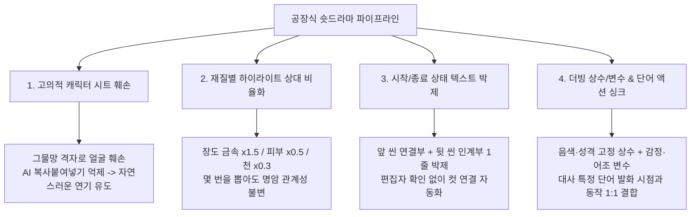

# 🏭 중국 전문 제작팀 AI 숏드라마 팩토리 프롬프트 전문 및 프로덕션 아키텍처
> **출처**: 중국 대형 숏폼 플랫폼(도우인·콰이쇼우·빌리빌리) 방영 숏드라마 제작팀 유출 실전 프롬프트 데이터셋  
> **핵심 가치**: 리롤(재생성) 비용 제로, 컷편집 병목 제로, 원샷 90% 일관성 달성을 위한 공장형 템플릿

---

## 📌 1. 숏드라마 팩토리 4대 핵심 아키텍처



---

## 📜 2. 프롬프트 전문 ①: 3D 선협(동양 판타지) 숏드라마 (10초 3컷 분경조 문법)

### [원문 (Original Chinese)]
```markdown
【全局风格质感】16:9横屏，玄幻3D国漫短剧质感，东方玄幻世界观，3D动漫风，电影级CG，神话史诗，4K高清，好莱坞顶级大片质感，超高细节，光线追踪，影视级细腻光影，Unreal Engine 5写实风格，高对比度明暗层次，粒子特效质感细腻，材质写实逼真，无字幕、无水印、无背景音乐；角色脸部表情与手部动作清楚；本场主要长刀寒光特效贴合适具和动作变化，画面干净。

【光影设计】修行5000K冷白；45°主侧光+180°轮廓逆光+低强度环境补光；全局深度阴影（深度0.8/软边0.2/距离10米）；人物面部眼神光；长刀金属高光×1.5、皮肤高光×0.5、布料高光×0.3；节点强度：发展×1.0/×1.2；保持全局曝光正常、人物面部光线均匀、单一光影方向、自然光源色。

【分镜组2｜反讽·开价｜时长：10秒】

场景：灵剑宗第九峰·茅草屋[@参考图4]外空地，日，外；画面近景，古夜[@参考图1]持刀立于空地中央偏左；中景，杜林[@参考图2]断腕跪地，路平[@参考图3]立在其身侧；两名随从虚影倒在两侧地上；日光洒落。

角色：古夜[@参考图1]、杜林[@参考图2]
背景低消角色：路平[@参考图3]（立在杜林[@参考图2]身侧旁观，不参与请主要表演）
物品：长刀
【禁止出现任何未在此处标注的角色或者角色名称任何的代称、场景、道具元素】

镜头1｜4.5秒｜近景/平视（反讽）
古夜[@参考图1]戏谑一笑，刀尖纹丝不动，目光凉凉地落在杜林[@参考图2]脸上。
【配音指令：古夜[@参考图1]｜清冷少年音｜隐忍克制、话少低沉｜状态（戏谑）｜语气（冷/缓/句尾上扬）：“就凭你在宗门做的那些事，我杀了你，都算为宗门除害。”】
本镜头仅展示以上内容，禁止添加任何未提及的人物、物体、特效或背景

镜头2｜1.5秒｜近景/平视（杜林[@参考图2]失语）
杜林[@参考图2]双目圆睁，喉头动了动，一个字也说不出来。
【配音指令：无】
本镜头仅展示以上内容，禁止添加任何未提及的人物、物体、特效或背景

镜头3｜4秒｜近景/平视（开价）
古夜[@参考图1]收刀后退半步，抬手，拇指与食指搓了搓。
【配音指令：古夜[@参考图1]｜清冷少年音｜隐忍克制、话少低沉｜状态（笑/开价）｜语气（轻/快/句尾上扬）：“简单，花钱消灾。一万灵石，买命！”】
本镜头仅展示以上内容，禁止添加任何未提及的人物、物体、特效或背景

分镜组结尾固定画面主体与状态：古夜[@参考图1]搓着手指；杜林[@参考图2]失语圆睁；路平[@参考图3]立在一旁。
```

---

### [한국어 정밀 번역 (Korean Translation)]
```markdown
【전체 스타일·질감】16:9 가로화면, 선협 3D 중국 애니 숏드라마 질감, 동양 판타지 세계관, 3D 애니풍, 영화급 CG, 신화 서사시, 4K 고화질, 헐리우드 최고급 블록버스터 질감, 초고밀도 디테일, 레이트레이싱, 영화급 섬세한 광영, Unreal Engine 5 사실주의 스타일, 고대비 명암 계조, 파티클 이펙트 질감 섬세, 재질 사실적, 자막 없음·워터마크 없음·배경음악 없음; 캐릭터 얼굴 표정과 손 동작 명확; 본 씬의 주 이펙트는 장도(長刀)의 한광(寒光)이며 소도구와 동작 변화에 밀착. 화면은 깔끔하게.

【광영 설계】수행 5000K 냉백색; 45° 주(主) 사이드광 + 180° 림 역광 + 저강도 환경 보조광; 전역 심도 섀도(깊이 0.8 / 소프트엣지 0.2 / 거리 10m); 인물 얼굴 아이라이트; 장도 금속 하이라이트 ×1.5, 피부 하이라이트 ×0.5, 천 하이라이트 ×0.3; 노드 강도: 전개 ×1.0 / ×1.2; 전역 노출 정상 유지, 인물 얼굴 조명 균일, 광영 방향 단일, 자연광원 색 유지.

【분경조 2 ｜ 조롱·값 부르기 ｜ 길이: 10초】

장면: 영검종 제9봉·초가집[@참고도4] 밖 공터, 낮, 야외; 근경, 고야[@참고도1]가 도를 들고 공터 중앙 약간 왼쪽에 서 있음; 중경, 두림[@참고도2]이 손목 잘린 채 무릎 꿇고 있고, 노평[@참고도3]이 그 옆에 서 있음; 수하 두 명의 흐릿한 실루엣이 양쪽 바닥에 쓰러져 있음; 햇빛이 내리쬔다.

캐릭터: 고야[@참고도1], 두림[@참고도2]
배경 저비중 캐릭터: 노평[@참고도3] (두림[@참고도2] 옆에 서서 방관, 선명한 주연 연기에는 참여하지 않음)
소도구: 장도
【여기 명시되지 않은 캐릭터, 캐릭터명의 어떠한 대체 호칭, 장면, 소도구 요소도 등장 금지】

컷1 ｜ 4.5초 ｜ 근경/아이레벨 (조롱)
고야[@참고도1]가 희롱하듯 웃는다. 칼끝은 미동도 없고, 시선은 차갑게 두림[@참고도2]의 얼굴에 떨어진다.
【더빙 지시: 고야[@참고도1] ｜ 차갑고 맑은 소년 음색 ｜ 눌러 참고 자제함, 말수 적고 낮게 ｜ 상태(조롱) ｜ 어조(차갑게/느리게/문장 끝 올림): “네가 종문에 저지른 짓들만 놓고 봐도, 내가 널 죽이는 건 종문의 해악을 제거하는 셈이지.”】
본 컷은 위 내용만 표현. 언급되지 않은 인물·물체·이펙트·배경 추가 금지

컷2 ｜ 1.5초 ｜ 근경/아이레벨 (두림[@참고도2] 실어)
두림[@참고도2]이 두 눈을 부릅뜬다. 목울대가 움직이지만 한 글자도 내뱉지 못한다.
【더빙 지시: 없음】
본 컷은 위 내용만 표현. 언급되지 않은 인물·물체·이펙트·배경 추가 금지

컷3 ｜ 4초 ｜ 근경/아이레벨 (값 부르기)
고야[@참고도1]가 도를 거두고 반 발짝 물러선다. 손을 들어 엄지와 검지를 비빈다.
【더빙 지시: 고야[@참고도1] ｜ 차갑고 맑은 소년 음색 ｜ 눌러 참고 자제함, 말수 적고 낮게 ｜ 상태(웃음/값 부르기) ｜ 어조(가볍게/빠르게/문장 끝 올림): “간단하다. 돈으로 액을 때워라. 영석(靈石) 일만 개, 목숨값이다!”】
본 컷은 위 내용만 표현. 언급되지 않은 인물·물체·이펙트·배경 추가 금지

분경조 종료 시 고정 화면 주체와 상태: 고야[@참고도1]는 손가락을 비비고 있음; 두림[@참고도2]은 말을 잃고 눈을 부릅뜬 상태; 노평[@참고도3]은 옆에 서 있음.
```

---

## 📜 3. 프롬프트 전문 ②: 실사 시대극 숏드라마 (Dreamina Seedance 2.5 전용 / 10초 연속촬영 문법)

### [원문 (Original Chinese)]
```markdown
【即梦 Dreamina Seedance 2.5 ｜ 《题西林壁：我知道……先等等》S05 ｜ 10秒 ｜ 16:9 ｜ 真人实拍快节奏版】

【输入模式与人物素材绑定】
Omni Reference / 三组真人参考生成。
@女孩=image 1=xiaoyu_girl_live_action_unobstructed_asset_v2.png: 作为女孩唯一真人身份参考，锁定同一张脸、真实年龄、双丸子头、齐刘海、儿童体型，以及白色连帽卫衣、浅灰运动裤和白色运动鞋。
@苏轼=image 2=tixilin_chr002_sushi_live_action_v1.png: 作为苏轼唯一真人身份参考，锁定同一张脸、年龄、发髻、胡须、身形、灰青色麻布长袍、草编芒鞋和青竹杖。
@山中路人=image 3=tixilin_bg001_mountain_extras_live_action_v1.png: 只负责锁定远处僧侣、樵夫和香客的时代身份与服装，不改变女孩和苏轼的脸。
@标签只用于素材调用，不生成为画面文字。

【真人风格锁定】
即梦 Seedance 2.5生成10秒、16:9横屏、24fps真人电影实拍视频。真实中国演员、自然皮肤、独立湿发丝、粗麻衣物、草编鞋、湿石和青苔真实质感。多云白昼的庐山山路，冷灰绿色调，墨色云雾被山风推动，湿滑石阶反射柔和天光；35mm低机位、24mm环境揭示和50mm人物反打快速切换。

【10秒连续镜头】
0—2秒：从S04鞋底接近填满画面的状态开始，35mm贴地低机位，一只白色运动鞋沿同一运动方向重重落在湿漉漉的青苔石阶上，鞋底挤出细小水珠并轻微打滑；女孩的小腿立即绷紧，身体向侧前方踉跄半步，脱口惊呼：“哇！” 镜头快速横移，旁边一双黑色草编芒鞋稳稳落地，青竹杖同时点中石缝，发出清脆杖声。

2—4秒：切24mm略低机位环境中景，镜头从两双鞋沿青竹杖迅速抬升，云雾被一阵山风撕开，显露站在石阶上的苏轼；他满脸汗水，灰青色麻布长袍下摆系在腰间，青竹杖支撑身体，眼睛明亮。女孩在画面左侧刚刚站稳，抬头盯着他；后方僧侣、樵夫和香客停在雾中，惊讶地看向苏轼，只保留低声人群气息和衣料摩擦声。

4—7.5秒：切50mm苏轼中近景，女孩的白色运动鞋虚化在左下前景。苏轼先低头打量鞋面，再抬眼看向女孩，眉毛扬起，爽朗大笑一声，右手握稳竹杖，左手指着她的鞋，带着新奇与打趣完整说：“好怪的小先生！这双鞋，怕是走遍汴京也买不到吧？” 说“好怪”时笑纹展开，说“这双鞋”时手指落向鞋面，说“汴京”时抬眼观察女孩反应。

7.5—10秒：硬切50mm女孩正面中近景，苏轼肩部和竹杖虚化在右前景。女孩先低头看自己的鞋，再迅速抬头端详苏轼的脸、胡须与发髻；她眼睛逐渐睁大，嘴唇微张，身体不由自主向前半步，带着震惊和不敢相信完整问：“你……你是苏东坡？” 说第一个“你”时短暂停顿，第二个“你”时确认性抬眉，说“苏东坡”时目光牢牢锁定他的眼睛。尾声切苏轼眼角带笑的反应近景，他准备回答。

【表演与节奏锁定】
运动鞋落地、打滑、芒鞋与竹杖稳稳落地构成一条连续动作链；云雾揭开后立即展示人物关系。苏轼从观察鞋子自然过渡到大笑和打趣，语速爽朗清楚。女孩从失衡惊呼、迅速站稳、观察古装人物到认出苏轼，反应逐层升级但不拖延。人群只作为远景空间层次，不抢对白和主体视线。

【人物与状态连续性】
女孩只认image 1，苏轼只认image 2，山中路人只认image 3。女孩保持白色运动鞋，不变成橙色鞋；苏轼的发髻、胡须、灰青麻布长袍、黑色草编芒鞋与青竹杖全程一致。人物在低头、抬头、说话和快速切换时保持各自同一张脸、年龄、肤色、发型、身形与服装。湿石阶、青苔、雾气方向和人物站位连续。

【尾帧与S06衔接】
50mm苏轼反应近景，青竹杖立在身侧，眼角带笑，目光看着女孩，嘴唇刚要张开。S06从苏轼回答：“东坡在此。不过，我现在还没心情写诗。”开始。

【CORE GUIDELINES ｜ 最高优先级后缀】
Strictly follow the prompt descriptions without any deviation. Absolutely NO background music (BGM); only retain ambient sound effects and raw character voices. The spoken lines must perfectly match the exact words provided, delivered fully and completely in Mandarin Chinese. Absolutely NO subtitles.
```

---

### [한국어 정밀 번역 (Korean Translation)]
```markdown
【지몽(即梦) Dreamina Seedance 2.5 ｜ 《제서림벽: 나는 알아…… 잠깐 기다려》S05 ｜ 10초 ｜ 16:9 ｜ 실사 촬영 속도감 버전】

【입력 모드와 인물 소재 바인딩】
Omni Reference / 3조 실사 참조 생성.
@여자아이 = image 1 = xiaoyu_girl_live_action_unobstructed_asset_v2.png: 여자아이의 유일한 실사 정체성 참조로서, 동일한 얼굴·실제 나이·양갈래 만두머리·일자 앞머리·아동 체형, 그리고 흰 후드 스웨트셔츠·연회색 트레이닝 바지·흰 운동화를 고정.
@소식(蘇軾) = image 2 = tixilin_chr002_sushi_live_action_v1.png: 소식의 유일한 실사 정체성 참조로서, 동일한 얼굴·나이·상투·수염·체형·회청색 마 도포·초혜(草鞋)·청죽 지팡이를 고정.
@산중 행인 = image 3 = tixilin_bg001_mountain_extras_live_action_v1.png: 원경의 승려·나무꾼·참배객의 시대 정체성과 복장만 담당하며, 여자아이와 소식의 얼굴은 바꾸지 않는다.
@태그는 소재 호출용일 뿐, 화면 문자로 생성하지 않는다.

【실사 스타일 락】
지몽 Seedance 2.5로 10초·16:9 가로·24fps 실사 영화 촬영 영상 생성. 실제 중국 배우, 자연스러운 피부, 낱낱이 분리된 젖은 머리카락, 굵은 마 의류, 초혜, 젖은 돌과 이끼의 사실적 질감. 흐린 낮의 여산(廬山) 산길, 냉회녹 색조, 먹빛 운무가 산바람에 밀려간다, 미끄러운 석계가 부드러운 천광을 반사; 35mm 로우앵글, 24mm 환경 노출, 50mm 인물 리버스를 빠르게 전환.

【10초 연속 촬영】
0—2초: S04의 신발 밑창이 화면을 거의 채운 상태에서 시작. 35mm 지면 밀착 로우앵글. 흰 운동화 한 짝이 직전과 같은 운동 방향으로 젖은 이끼 석계에 무겁게 착지하고, 밑창이 잔 물방울을 밀어내며 살짝 미끄러진다; 여자아이의 종아리가 즉시 긴장하고, 몸이 측전방으로 반 걸음 휘청이며 저도 모르게 외친다: “와!” 카메라가 빠르게 횡이동하고, 옆에서 검은 초혜 한 쌍이 안정적으로 착지하며 청죽 지팡이가 동시에 돌 틈을 짚어 맑은 지팡이 소리를 낸다.

2—4초: 24mm 약간 낮은 앵글의 환경 미들샷으로 전환. 카메라가 두 쌍의 신발에서 청죽 지팡이를 따라 빠르게 상승하고, 산바람 한 줄기가 운무를 찢어 석계 위에 선 소식을 드러낸다; 그의 얼굴은 땀에 젖고, 회청 마 도포 밑단은 허리에 묶었고, 청죽 지팡이로 몸을 지탱하며 눈은 밝다. 여자아이는 화면 왼쪽에서 막 균형을 잡고 고개를 들어 그를 응시한다; 후방의 승려·나무꾼·참배객이 안개 속에 멈춰 서서 놀란 눈으로 소식을 본다. 낮은 군중 숨소리와 옷감 마찰음만 유지.

4—7.5초: 50mm 소식 미디엄클로즈로 전환. 여자아이의 흰 운동화가 좌하단 전경에 아웃포커스로 걸린다. 소식이 먼저 고개를 숙여 신발을 살피고, 다시 눈을 들어 여자아이를 보고, 눈썹을 올리며 호쾌하게 한 번 크게 웃고, 오른손으로 지팡이를 단단히 잡고, 왼손으로 그녀의 신발을 가리키며, 신기함과 놀림을 담아 온전히 말한다: “괴상한 꼬마 선생 아니신가! 그 신발, 변경(汴京)을 다 돌아도 못 살 물건일 텐데?” “괴상한”이라 말할 때 웃음주름이 펴지고, “그 신발”이라 말할 때 손가락이 신발로 떨어지고, “변경”이라 말할 때 눈을 들어 여자아이의 반응을 살핀다.

7.5—10초: 하드컷으로 50mm 여자아이 정면 미디엄클로즈. 소식의 어깨와 지팡이가 우측 전경에 아웃포커스. 여자아이가 먼저 자기 신발을 내려다보고, 재빨리 고개를 들어 소식의 얼굴·수염·상투를 살핀다; 눈이 점점 커지고 입술이 살짝 벌어지며, 몸이 저도 모르게 반 걸음 앞으로 나간다. 충격과 불신을 담아 온전히 묻는다: “당신…… 당신이 소동파?” 첫 번째 “당신”에서 짧은 정지, 두 번째 “당신”에서 확인하듯 눈썹을 올리고, “소동파”라 말할 때 시선을 그의 눈에 단단히 고정한다. 마지막에 눈웃음 짓는 소식의 리액션 클로즈업으로 전환, 그가 답하려 한다.

【연기와 리듬 락】
운동화 착지, 미끄러짐, 초혜와 지팡이의 안정적 착지가 하나의 연속 동작 사슬을 구성한다; 운무가 걷힌 직후 즉시 인물 관계를 제시한다. 소식은 신발 관찰에서 대소와 놀림으로 자연스럽게 이행하며, 말은 호쾌하고 명료하게. 여자아이는 균형 상실과 경악, 신속한 회복, 고대 복장 인물 관찰을 거쳐 소식을 알아보기까지 반응이 층층이 상승하되 늘어지지 않는다. 군중은 원경 공간 레이어로만 기능하며 대사와 주체 시선을 빼앗지 않는다.

【인물·상태 연속성】
여자아이는 image 1만, 소식은 image 2만, 산중 행인은 image 3만 인식한다. 여자아이는 흰 운동화를 유지하며 주황 신발로 변하지 않는다; 소식의 상투·수염·회청 마 도포·검은 초혜·청죽 지팡이는 전 구간 일치한다. 인물은 고개를 숙이거나 들 때, 말할 때, 빠르게 컷이 전환될 때에도 각자 동일한 얼굴·나이·피부색·헤어스타일·체형·의상을 유지한다. 젖은 석계·이끼·안개 방향·인물들의 입지가 연속된다.

【종료 프레임과 S06 연결】
50mm 소식 리액션 클로즈업. 청죽 지팡이가 몸 옆에 세워져 있고, 눈웃음을 띠고, 시선은 여자아이를 향하고, 입술이 막 열리려는 상태. S06은 소식의 답 “동파가 여기 있소. 다만 나는 지금 시를 쓸 마음이 없구려.”부터 시작.

【CORE GUIDELINES ｜ 최우선 접미】
프롬프트 서술을 어떠한 이탈도 없이 엄격히 따를 것. 배경음악(BGM) 절대 금지 — 앰비언트 효과음과 인물 생목소리만 유지. 대사는 제공된 문구와 정확히 일치해야 하며, 표준 중국어로 온전히·완전히 발화할 것. 자막 절대 금지.
```
