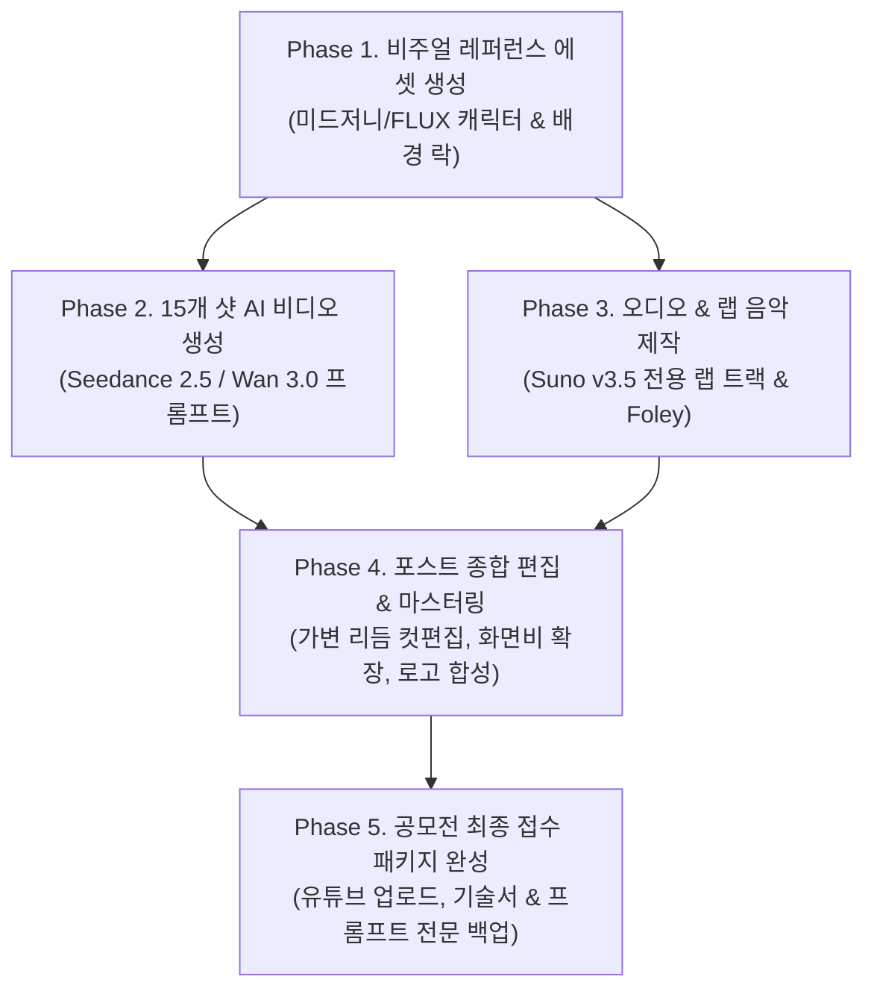

# 2026 화성특례시 AI CF 제작 마스터 플랜 & 체크리스트

> **프로젝트명**: 《EVOLUTION : 기적의 해상도 (From Soil to Stars)》  
> **공모 부문**: 2026 화성특례시 AI CF 공모전 「제6회 별별화성 Awards」  
> **출품 규격**: 16:9 가로, 약 48~55초 (1분 이하), 1920×1080 이상 (4K 업스케일 권장)  
> **목표 훈격**: **대상 (1,000만 원, 화성시장상)**

---

## 📌 1. 핵심 제작 콘셉트 요약

1. **4단계 미디어 질감의 진화 (Media Medium Evolution)**:
   - `00-05s`: 1970년대 아날로그 16mm 흑백 필름 (거친 그레인, 스크래치, 흑백 비네팅)
   - `05-09s`: 1980년대 컬러 브라운관 CRT TV (RGB 스캔라인, 볼록한 곡면, 아날로그 색감)
   - `09-16s`: 1990년대 4:3 홈비디오 캠코더 (테이프 노이즈, 4:3 비율 ➔ 16:9 와이드 확장)
   - `16-55s`: 2026년 4K 아나모픽 와이드 시네마 (크리스탈 4K, 헐리우드 블록버스터 룩)
2. **편집 호흡의 반전 (The Editorial Shift)**:
   - 전반부(역사 파트): **1~3초 비트 싱크 하드 컷 몽타주 (`kinetic-beat-montage`)**
   - 후반부(화성 자랑): **4~5초 역동적 활공 카메라 무빙 (FPV 드론, 360도 회전, 스케일 과시)**
3. **가변 리듬 (1~5초 페이싱)**:
   - 1~1.5초(불꽃/공무원 발/반도체/연구원 손)의 **강렬한 찰나의 타격감**
   - 4.5~5초(동탄 마천루 활공/서해 바다 케이블카/호수공원 루나쇼)의 **압도적 시각 쾌감**
4. **오디오**:
   - 올드스쿨 턴테이블 잡음에서 시작해 2026년 폭발적인 K-힙합 트랩으로 진화하는 **화성시 전용 랩 음악 & Foley SFX**

---

## 📋 2. 우리가 제작해야 할 5대 핵심 파이프라인 & 작업 목록 (To-Do List)



---

### [Phase 1] 비주얼 레퍼런스 & 히어로 이미지 제작 (Image Assets)
AI 비디오 모델의 얼굴 및 배경 붕괴(Morphing)를 0%로 차단하기 위한 사전 레퍼런스 에셋 생성 단계입니다.

- [ ] **1. 주인공 2인 캐릭터 락 에셋 (@Reference Image)**
  - [ ] `@boy_1995`: 1995년 동탄면 논두렁을 달리는 8세 소년 (밀짚모자, 흙 묻은 고무신, 단정한 헤어)
  - [ ] `@engineer_2026`: 2026년 동탄 테크노밸리 30대 청년 수석 연구원 (모던 수트, 스마트글래스, 당당한 눈빛)
- [ ] **2. 1970~1990년대 역사적 배경 에셋**
  - [ ] 1970s 거친 서해안 갯벌과 바지락 그물망 (흑백 16mm 질감)
  - [ ] 1980s 붉은 쇳물과 용접 불꽃이 튀는 주조공장 및 현대 포니 조립 라인
  - [ ] 1990s 화성군 동탄면의 끝없는 황금빛 논두렁과 비포장 흙길
- [ ] **3. 2026년 화성특례시 3대 핵심 랜드마크 에셋**
  - [ ] 동탄 테크노밸리 초고층 마천루 숲 & 미래형 자율주행 모빌리티
  - [ ] 제부도 서해랑 해상 케이블카 & 전곡항 마리나 요트 물보라
  - [ ] 동탄호수공원 루나쇼(LUNA SHOW) 거대한 달빛 분수와 미디어아트 레이저

---

### [Phase 2] 15개 샷 AI 비디오 프롬프트 제작 (Video Prompts)
`AGENTS.md` 헌법(물리 동사, 85mm 클로즈업, 서브텍스트 물리화)과 `kinetic-beat-montage` 문법을 적용한 프롬프트 작성.

- [ ] **1. 타깃 생성기 결정**:
  - `Seedance 2.5` (Artlist - 물리 액션, 인물 연기 최적) 또는 `Wan 3.0` (35mm 실사 질감 최적)
- [ ] **2. 15개 샷별 맞춤 프롬프트 전문 작성**:
  - [ ] **Shot 1 (3초)**: 1970s 흑백 16mm 갯벌 농부의 거친 손 그물 털기
  - [ ] **Shot 2 (2초)**: 흑백 경운기 흙길 뒤로 달리는 소년의 고무신 발
  - [ ] **Shot 3 (1초)**: 1980s CRT 주조공장 붉은 쇳물과 용접 불꽃 스파크
  - [ ] **Shot 4 (2초)**: 1980s 포니 자동차 조립 라인 통과
  - [ ] **Shot 5 (1초)**: 1980s 화성군 청사 간판 아래 서류 들고 뛰는 발걸음
  - [ ] **Shot 6 (3초)**: 1990s 4:3 캠코더 동탄면 논두렁 전력질주하는 소년
  - [ ] **Shot 7 (1.5초)**: 반도체 웨이퍼 위 푸른 레이저 스캔 인서트
  - [ ] **Shot 8 (2.5초)**: 밀짚모자 날아가며 4:3 ➔ 16:9 와이드로 찢어지는 화면 확장
  - [ ] **Shot 9 (5초)**: 2026 4K 자율주행 모빌리티 따라 동탄 마천루 활공 (FPV 드론)
  - [ ] **Shot 10 (1.5초)**: 통유리 랩에서 홀로그램 데이터 넘기는 연구원 손끝
  - [ ] **Shot 11 (4.5초)**: 서해랑 케이블카 수면 급하강 & 전곡항 요트 물보라 관통
  - [ ] **Shot 12 (2초)**: 융건릉 솔숲길 아침 햇살 맞으며 조깅하는 시민들
  - [ ] **Shot 13 (5초)**: 동탄호수공원 루나쇼 360도 회전 레이저 분수 폭발
  - [ ] **Shot 14 (2초)**: 루나쇼 불빛 아래 환호하는 아이들과 가족들의 웃음
  - [ ] **Shot 15 (3.5초)**: 야경 마천루 배경 청년 연구원의 당당한 미소 (85mm 클로즈업)
  - [ ] **Shot 16 (4.5초)**: 화성특례시 공식 로고 & 슬로건 락
- [ ] **3. 파이썬 글자 수 정밀 검증 및 프롬프트 파일 저장**:
  - `projects/2026_hwaseong_ai_cf/prompts_[생성기].md`

---

### [Phase 3] 사운드트랙 & 전용 랩 음악 제작 (Audio & BGM)
- [ ] **1. 화성시 전용 CF 랩 가사 확정 (4막 구성)**:
  - Act 1 (LP 노이즈 & 나지막한 독백): *"먼지 날리던 흙길, 이름조차 없던 곳 / 아무것도 없던 땅에 품었던 단 하나의 꿈..."*
  - Act 2 (아날로그 80s 붐뱁): *"빨간 쇳물 위에 땀방울을 붓고 / 불꽃을 튀기며 세운 기적의 주춧돌!"*
  - Act 3 (90s 비트 가속): *"논두렁을 달리던 소년의 시선 / 세계를 집어삼킬 반도체의 비전!"*
  - Act 4 (2026 트렌디 K-힙합 트랩 드롭): *"Look at us now, 상상이 현실이 돼! / 흙길에서 마천루, 100만의 무대로! / 밤하늘을 수놓는 루나의 빛처럼 / 여긴 대한민국 가장 뜨거운 심장, 화성!"*
  - Ending: *"30년의 기적, 이제 미래를 켠다. 모두의 행복, 더 큰 화성."*
- [ ] **2. Suno v3.5 / Udio 전용 음원 생성 & 셀렉션**:
  - 장르: `Old-school vinyl intro into energetic modern Korean Hip-hop trap drop, heavy 808 bass, punchy brass, cinematic orchestration build-up`
- [ ] **3. 정밀 폴리 효과음(SFX) 라이브러리 구축**:
  - 흙 밟는 소리, 지포/용접 불꽃 스파크, 턴테이블 스크래치, 반도체 레이저 비프음, 화면 찢어지는 우쉬(Whoosh), 케이블카 물보라, 루나쇼 분수 폭발음.

---

### [Phase 4] 포스트 프로덕션 종합 편집 (Editing & Composite)
- [ ] **1. 가변 리듬 컷편집**: 1~5초 가변 비트에 맞춘 정밀 컷 싱크
- [ ] **2. 광학 질감 필터 및 화면비 확장 이펙트**:
  - 00~05s: 흑백 16mm 그레인 & 먼지 오버레이
  - 05~09s: 80s CRT RGB 스캔라인 & 곡면 왜곡
  - 09~16s: 4:3 필러박스(Pillarbox) & VHS 글리치
  - **13.5~16s: 4:3 블랙바가 양옆으로 찢어지며 16:9 와이드로 확장되는 모션 그래픽**
  - 16~55s: 무손실 4K HDR 아나모픽 렌즈 플레어
- [ ] **3. 필수 요소 삽입 (결격 방지)**:
  - [ ] 화성특례시 공식 로고(CI/BI) 및 슬로건(「모두의 행복, 더 큰 화성」) 엔딩 삽입
  - [ ] 엔딩 크레딧 출처 표기 (음원, 폰트, AI 생성 툴 명시)

---

---

### [Phase 5] 최종 공모전 접수 패키지 구축 (Submission Package)
- [ ] **1. 유튜브 업로드 (전체 공개, 1080p/4K)**
  - **공식 권장 필수 해시태그 묶음**:
    ```text
    #별별화성_Awards #별별화성_어워즈 #화성특례시_AI_CF_공모전 #화성특례시 #빛나는도시 #특별한시민 #모두의행복더큰화성
    ```
  - **유튜브 복사-붙여넣기용 설명문(Description) 템플릿**:
    ```text
    [2026 화성특례시 AI CF 공모전 「제6회 별별화성 Awards」 출품작]
    
    작품명: EVOLUTION : 기적의 해상도 (From Soil to Stars)
    기획/연출: AI 시네마틱 디렉팅 팀
    
    "30년 전 먼지 날리던 시골 흙길에서, 대한민국에서 가장 젊고 역동적인 100만 화성특례시로."
    1970년대 흑백 필름에서 2026년 4K 아나모픽 와이드로 진화하는 영상 미디어의 해상도와 함께, 
    논두렁을 달리던 소년의 꿈이 세계 최고의 반도체와 미래 모빌리티로 피어나는 30년의 기적을 담았습니다.
    
    ■ 활용된 화성특례시 공식 상징물 및 BI:
    - 공식 BI: 화성특례시 「특별한 시민, 빛나는 도시」 (엔딩 삽입)
    - 시의 꽃: 목백일홍 (동탄 마천루를 배경으로 만개하는 열정)
    - 시의 나무: 궁평리 소나무 (바닷바람을 막아주는 변치 않는 뿌리)
    - 시의 새: 화성갯벌 알락꼬리마도요 (오프닝의 생태적 비상)
    
    ■ 제작 도구 (AI Tools & Workflow):
    - Video AI: Seedance 2.5, Wan 3.0
    - Visual Asset: Midjourney v6.1, FLUX
    - Audio & Music: Suno v3.5, Pro Tools SFX
    
    ■ 라이선스 및 출처 표기 (Credits):
    - 공식 로고 및 심볼: 화성시청 공공저작물(BI) 활용
    - BGM: 오리지널 AI 생성 트랙 (자체 제작)
    - 폰트: 프리텐다드(Pretendard - OFL)
    
    #별별화성_Awards #별별화성_어워즈 #화성특례시_AI_CF_공모전 #화성특례시 #빛나는도시 #특별한시민 #모두의행복더큰화성
    ```
- [ ] **2. 공모전 접수 폼 기술서 작성**:
  - 작품명: 《EVOLUTION : 기적의 해상도 (From Soil to Stars)》
  - 기획의도 및 작품 설명 정리
  - 주 사용 AI 툴 목록 정리
- [ ] **3. 전체 프롬프트 전문 영구 백업**:
  - 주최 측 사후 3일 이내 프롬프트 제출 요청 대비용 완벽 백업 파일 (`submission_prompts_backup.md`) 구축.

---

### [Phase 6] 최종 엄선된 필수 레퍼런스 에셋 매핑표 (`projects/2026_hwaseong_ai_cf/assets/`)
> **감독님 절대 원칙 준수**:
> 1. **태그명 = 사진파일이름 (18자 이하 영문)** 1:1 완벽 일치.
> 2. **실제 프롬프트에 꼭 필요한 핵심 락 에셋만 엄선**: 불필요한 사진 남발로 인한 비디오 AI 주의력(Attention) 분산 차단.
> 3. **저해상도 사진 억지 확대(Upscaling) 전량 영구 퇴출**: 블러/화질 저하 유발 에셋을 버리고, 일반 장면은 Wan 3.0 최고 성능의 35mm 물리 프롬프트로 4K 초고화질 직접 렌더링.

#### ■ Part-1 (00:00 - 00:16 / 16초) - 1970~1995 역사 & 진화
* **필수 락 에셋 (1장)**:
  - `@samsung_euv` (11자) ➔ [`samsung_euv.jpg`](file:///Volumes/NVME/7.AI_vibe_coding/20260712_AI_Video_Tools/projects/2026_hwaseong_ai_cf/assets/samsung_euv.jpg) (1376×768 / 삼성전자 화성 EUV 라인 몬드리안 외경 / 텍스트 0%)
* **프롬프트 전담 렌더링 (7개 샷)**:
  - Shot 01 (알락꼬리마도요 비상), Shot 02 (소년 고무신 흙먼지 질주), Shot 03 (주조공장 용접 불꽃), Shot 04 (자동차 조립 라인), Shot 05 (공무원 가죽구두 질주), Shot 06 (동탄면 황금 논두렁), Shot 07 (클린룸 방진화 매치컷) ➔ **저해상도 사진 오염 없이 35mm 프롬프트로 극강의 4K 실사 렌더링**

#### ■ Part-2 (00:16 - 00:44 / 28초) - 2026 초격차 미래도시 & 시민 행복
* **필수 락 에셋 (1장)**:
  - `@bi_logo` (7자) ➔ [`bi_logo.png`](file:///Volumes/NVME/7.AI_vibe_coding/20260712_AI_Video_Tools/projects/2026_hwaseong_ai_cf/assets/bi_logo.png) (3508×2481 / 화성특례시 공식 슬로건 BI 300DPI 무손실 원본)
* **프롬프트 전담 렌더링 (7개 샷)**:
  - Shot 09 (동탄 마천루 활공), Shot 10 (K-City 자율주행 모빌리티), Shot 11 (서해랑 해상 케이블카 바다 횡단), Shot 12 (전곡항 요트 마리나), Shot 13 (융건릉 노송 숲길), Shot 14 (동탄호수공원 루나쇼), Shot 15 (시민 가족 환호), Shot 16 (목백일홍 매크로 꽃 만개 후 로고 안착) ➔ **프롬프트 전담으로 결함 없는 헐리우드 4K 시네마틱 렌더링**


