# 2026 화성특례시 AI 영상 콘티 및 스토리보드 (Storyboard Master)

- **작품명**: 《EVOLUTION : 기적의 해상도 (From Soil to Stars)》
- **규격**: 60초 총 3부작 구성 (Part 1: 30초 원테이크 + Part 2: 15초 + Part 3: 15초 = 총 60초)
- **오디오 연출 헌법**: BGM/음악/악기 100% 영구 배제, **오직 현실 물리 효과음(SFX Foley)과 현장음(Ambient)만 배치**
- **시각적 화면 질감 원칙**: 순수 16mm 은염 흑백(Monochrome) 아카이브 필름의 거친 입자감과 게이트 흔들림에서 시작하여, 빛바랜 세피아 골드 ➔ 16mm 거친 컬러 ➔ 35mm 공업 텅스텐 용광로와 안전 주물틀 ➔ 35mm 코닥 비전 필름 온기 ➔ 1990s 코다크롬 64 황금빛 들판 ➔ 무균 클린룸 순백광 ➔ ARRI Alexa 4K/65 디지털 시네마 ➔ 2026 초격차 8K HDR 헐리우드 블록버스터 마스터 렌즈로 진화
- **카메라 무빙 × 트랜지션 연출 헌법**: 단순 하드컷을 배제하고, 앞선 샷의 카메라 운동 에너지와 전경 물체(날개, 갈대, 흙먼지, 차체, 철탑, 물보라, 레이저 미스트)를 이용해 다음 샷으로 물 흐르듯 이어지는 거장 감독의 유기적 트랜지션 문법 100% 적용

---

## Part 1: 기원의 대지에서 나노 혁신까지 — 30초 무정지 원테이크 시퀀스 (00:00 - 00:30 / 10대 에셋)
> **[화면 질감 & 광학 특성]**: 순수 16mm 은염 흑백(Kodak Tri-X) 아카이브 질감 ➔ 세피아 갈대 ➔ 16mm 컬러 염전 ➔ 35mm Kodak Vision3 500T 텅스텐 용광로와 안전 주물틀 ➔ 1980s 빈티지 휠 & 비포장 흙길 ➔ 1990s 코다크롬 64 황금빛 들판 ➔ 무균 클린룸 나노 웨이퍼와 삼성 EUV 순백광 블룸

| 시퀀스 구간 / 내용 | 카메라 앵글 및 인비저블 트랜지션 기법 | 화면 질감 및 물리적 연출 묘사 | 참조 에셋 & 태그 |
| :--- | :--- | :--- | :--- |
| **00-04s: 기원의 갯벌 & 새의 비행** | **[Low Crab Drift ➔ Bird Body Foreground Object Wipe]** | **16mm 은염 흑백 아카이브 질감**: 갯벌 5cm 위 수평 크랩 ➔ 마도요가 하늘로 솟구치며 **새의 몸통과 깃털이 카메라 바로 앞을 0.2초간 완전히 가리고 지나가는 오브젝트 와이프** | 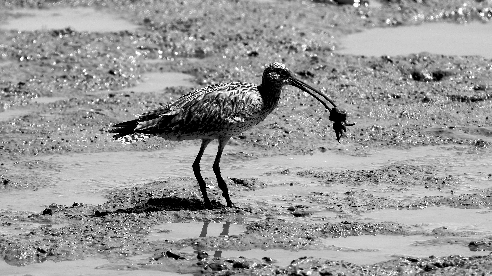 `@curlew_bird` |
| **04-07s: 우음도 갈대밭** | **[Bird Wipe Reveal ➔ Banking S-Curve Flight ➔ Lateral Smear]** | **빛바랜 세피아 골드 16mm 셀룰로이드**: 새 몸통이 벗겨지며 15도 더치 뱅킹 롤을 준 갈대밭 S자 곡선 비행 ➔ 갈대 이삭을 측면으로 긁고 지나가는 수평 모션 스미어 전환 | 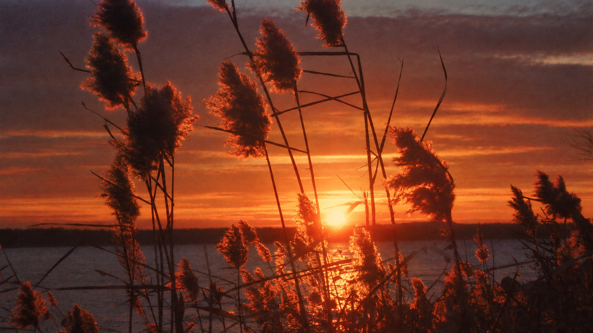 `@uumdo_reeds` |
| **07-10s: 매향리 염전** | **[Backward Pullback Retreat ➔ 90-Degree Top-Down Pitch Down]** | **거친 16mm 컬러 필름**: 전진하는 염부를 맞이하며 카메라가 뒤로 급격히 물러나는 **후진 리버스 풀백** ➔ 발꿈치 착지 순간 **90도 수직 탑다운 급강하 피치 다운 타격** | 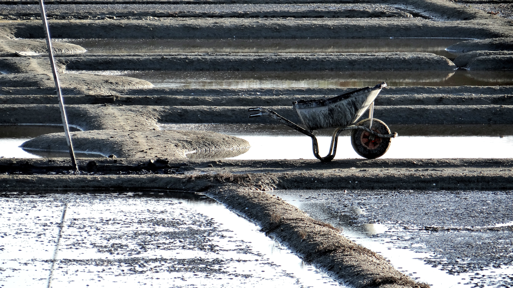 `@saltern_salt` |
| **10-13s: 불꽃과 용광로 쇳물 ➔ 회전 불꽃** | **[Downward Impact Match Cut ➔ Ladle Pour ➔ Spinning Spark Macro]** | **35mm 텅스텐 주조 필름**: 발걸음 타격 순간 어두운 제철소로 하향 매치컷 ➔ 안전 주물틀 래들 안으로 쇳물 수용 및 굳어가는 강철 슬래그 ➔ **강철 표면 위로 튄 주황빛 불꽃(Spark) 하나가 화면 정중앙에서 고속 회전** | 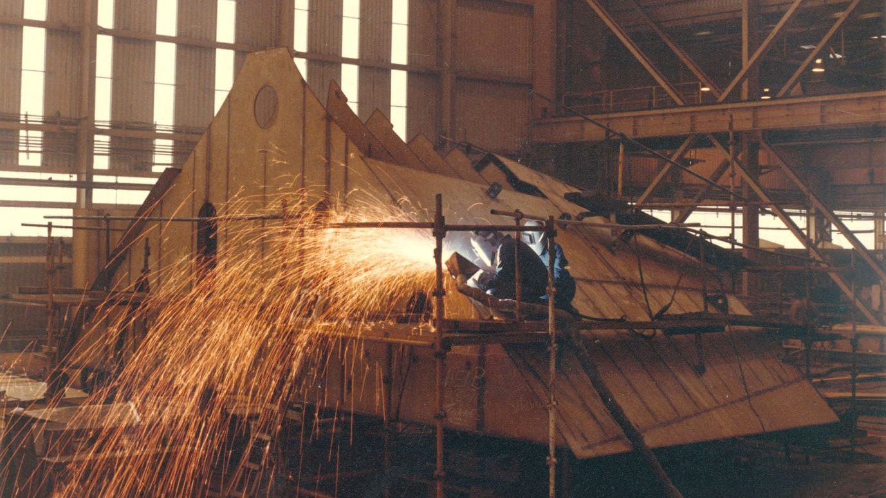 `@welder_sparks` 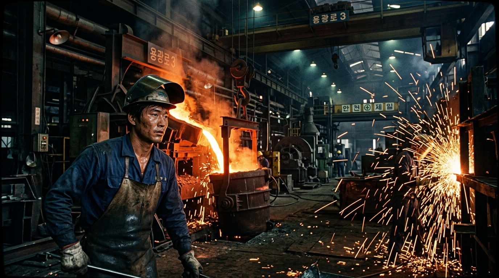 `@furnace_fire` 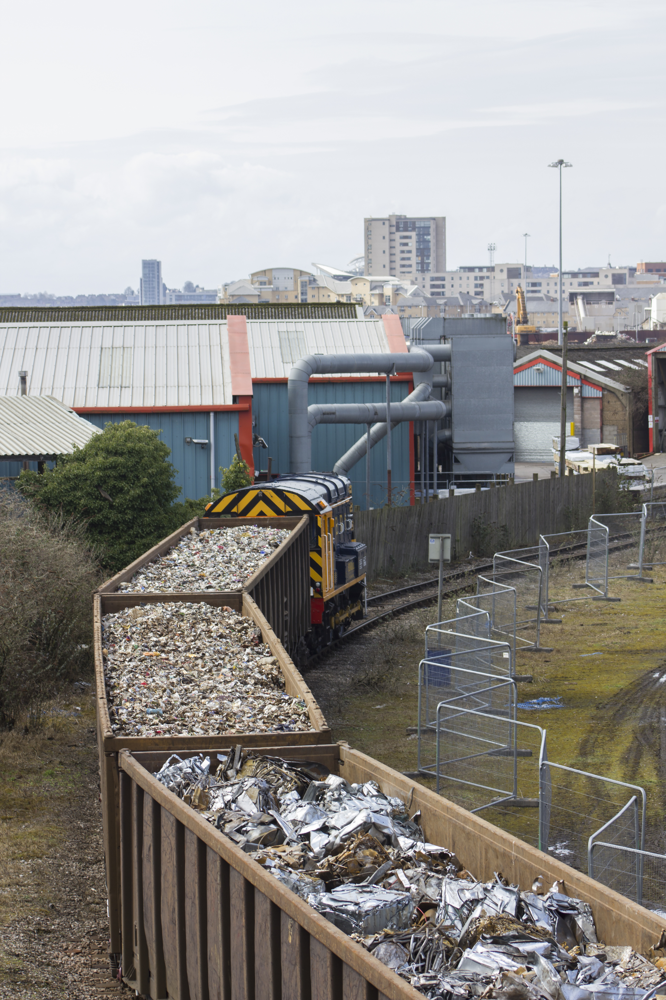 `@steel_scrap` |
| **13-17s: 회전 타이어 매치컷 ➔ 기계 기둥 와이프 ➔ 1995 질주** | **[Shape Match Cut ➔ Vertical Steel Pillar Lateral Wipe ➔ Sprint Reveal]** | **빈티지 35mm 필름 온기 ➔ 1995 코다크롬 64**: 회전 불꽃이 **시계방향으로 고속 회전하는 자동차 타이어 휠로 완벽 형태 매치컷(제철소 ➔ 자동차 공장 완벽 전환)** ➔ 회전 타이어 옆을 지나 우측 수평 이동 시 **조립 기계의 육중한 수직 강철 기둥(Pillar)이 렌즈 전경을 쓱 가로지르며 화면을 자연스럽게 덮고 벗겨내는 기계 기둥 와이프** ➔ 기둥 너머로 흙먼지를 박차고 폭발적으로 질주하는 청년 러너 등장 | 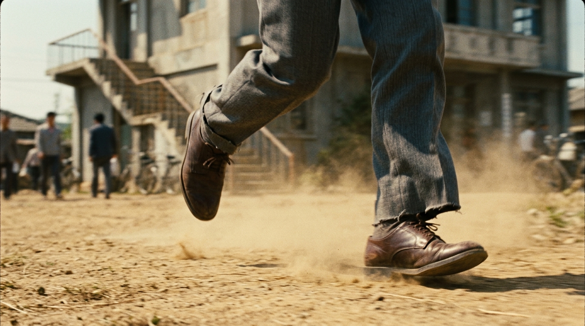 `@office_shoes`  `@ricefield_1995` |
| **17-21s: 전력 질주 유지 ➔ 눈동자 급속 크래시 줌** | **[Continuous Sprint Backward Tracking ➔ Instant Eye Pupil Crash Zoom]** | **1995 코다크롬 64**: **달리다 멈추거나 서지 않고 전력 질주 속도감 100% 유지!** 정면 후진 트래킹 카메라가 지체 없이 남자의 앞을 매섭게 쏘아보는 **검은 눈동자(동공) 속으로 번개처럼 초고속 크래시 줌인 돌진** |  `@ricefield_1995` |
| **21-25s: 웨이퍼 매치컷 ➔ 초고속 푸시아웃 풀백** | **[Eye Pupil-to-Wafer Morph ➔ Rapid Reverse Push-Out Pullback]** | **나노 무균 클린룸**: 검은 동공 원형이 **반도체 실리콘 웨이퍼 코어로 0.1초 만에 즉각 매치컷** ➔ 눈동자 크기였던 웨이퍼에서 **카메라가 뒤로 빠르게 빠지는 초고속 리버스 푸시아웃(풀백)** ➔ 레이저 격자가 흐르는 **300mm 웨이퍼 전체와 이를 든 연구원, 거대한 무균 클린룸 팹 전경이 시원하게 확장 노출** | 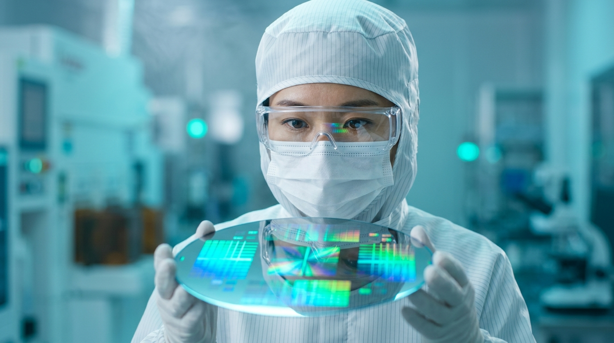 `@cleanroom_scientist` |
| **25-30s: 삼성 EUV & 순백광 페이드아웃** | **[Sky-to-Factory Crane Descent ➔ Airlock Doors Open ➔ Whiteout Fade-Out]** | **모던 4K 건축 시네마 선예도**: 하늘에서 삼성 공장(@samsung_euv) 몬드리안 거대 외관으로 매끄럽게 하강 ➔ 스테인리스 에어락 도어로 전진 ➔ 문이 스르륵 열리며 쏟아져 나온 눈부신 순백광이 화면 전체를 삼키는 **화이트아웃 페이드아웃 [End State]** | 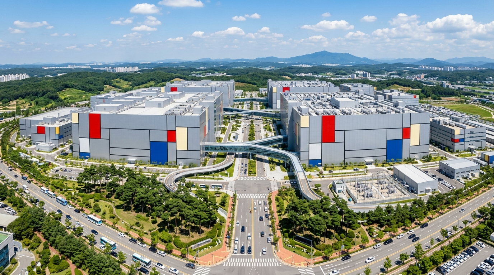 `@samsung_euv` |

---

## Part 2: 첨단과 서해 — 스마트 모빌리티에서 낙조까지 (00:30 - 00:45 / 8컷)
> **[화면 질감 & 광학 특성]**: ARRI Alexa 65 디지털 시네마 센서의 정밀한 다이내믹 레인지, 왜곡 없는 광학 렌즈, 서해안 골든아워

| 샷 번호 / 타임코드 | 카메라 앵글 및 트랜지션 기법 | 화면 질감 및 물리적 연출 묘사 | 참조 에셋 & 태그 |
| :--- | :--- | :--- | :--- |
| **Shot 01** (00.0-01.9s) | **[Pure White Optical Fade-In ➔ Low Wheel Tracking ➔ Lateral Fly-Past]** | **순백광 화이트 페이드인 & 유려한 좌측 패스바이**: 파트1 순백광 화이트아웃 엔딩과 100% 일치하는 **100% 완전한 순백 화면에서 시작하여 0.5초간 빛이 부드럽게 걷히며 페이드인** ➔ 회전하는 전기차 은빛 휠 로우앵글 추적 ➔ 보닛을 타고 넘는 좌측 곡선 모멘텀을 꺾지 않고 **차체 측면을 매끄럽게 스쳐 지나가는 측면 패스바이(Lateral Fly-Past)** | 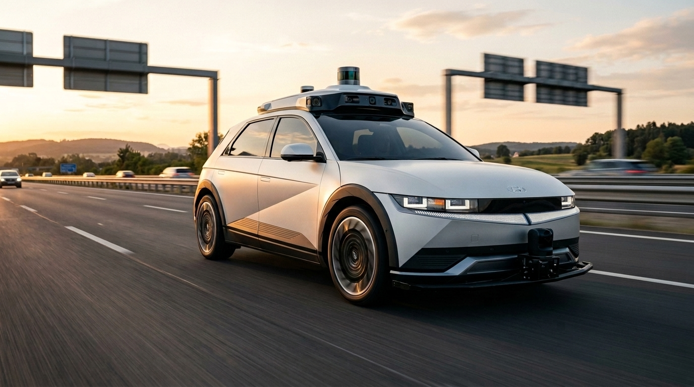 `@ioniq_auto` |
| **Shot 02** (01.9-03.7s) | **[Foreground Clear ➔ Layered Depth Reveal ➔ Massive Bus Body Wipe]** | **전경 차체 이탈 & 후경 버스 자연 노출 ➔ 거대 차체 오클루전 와이프**: 전기차 차체가 우측 전경으로 자연스럽게 빠져나가며 **뒤편 승강장에 대기 중이던 자율주행 셔틀버스(`@autonomous_bus`) 전면부가 자연스러운 심도 분리(Depth Reveal)로 노출** ➔ 버스 출발 가속 직후 **육중한 버스 측면 차체가 렌즈 전경을 0.1초간 완전히 스쳐 지나며 화면을 암전시키는 거대 오클루전 와이프** | 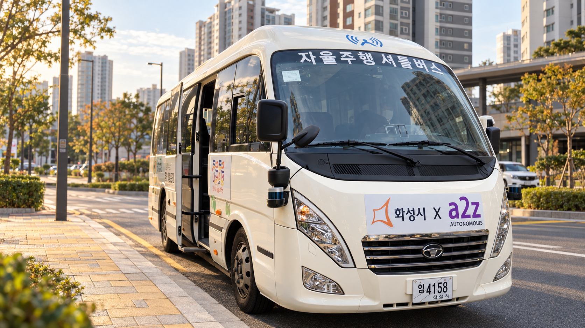 `@autonomous_bus` |
| **Shot 03** (03.7-05.6s) | **[Bus Wipe Reveal ➔ Tram Nose Tracking ➔ Continuous Forward Speed]** | **동탄 친환경 무가선 트램 & 지속 전진 속도감**: 버스 차체가 걷히며 도심 매립 궤도를 달리는 동탄 트램(`@dongtan_tram`) 전면부 노출 ➔ 트램 앞을 스쳐 질주하며 감속 없이 전진 모멘텀 유지 | 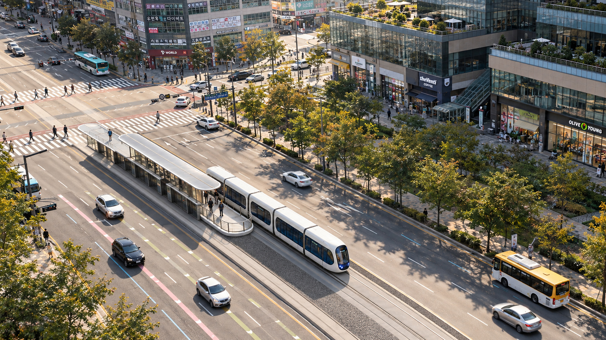 `@dongtan_tram` |
| **Shot 04** (05.6-07.5s) | **[Red Wilderness Entry ➔ 180-Degree Low-Altitude Fossil Rock Orbit]** | **우음도 공룡알 화석산지 & 화석 암반 저공 오비탈 아크**: 갈대밭 한가운데 우뚝 솟은 **거대한 붉은 공룡알 화석 암반 바위(Fossil Rock Outcrop)를 정중앙에 고정하고 지상 30cm 저공에서 180도로 타이트하게 휘감아 도는 역동적인 오비탈 아크(Orbital Sweep)** | 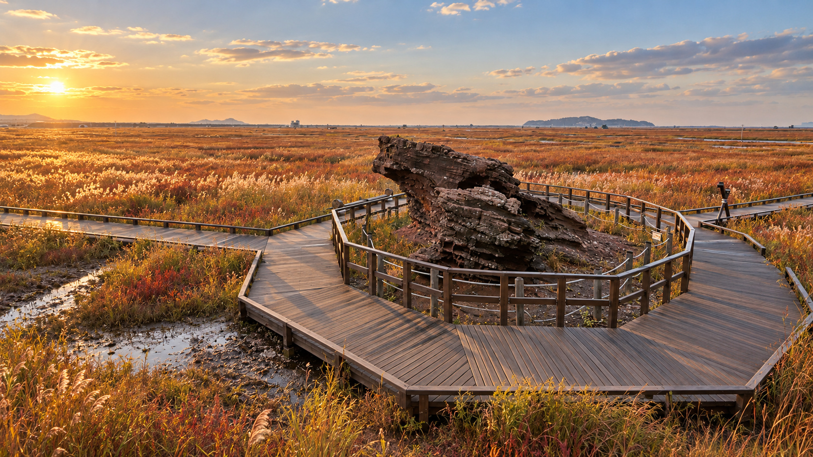 `@dinosaur_egg_reeds` |
| **Shot 05** (07.5-09.4s) | **[Orbital Exit ➔ Curved Red-Brick Memorial & Observation Tower Pass-By]** | **매향리 붉은 벽돌 기념관 & 나선형 전망 타워 100% 일치**: 화석 바위 오비탈에서 빠져나와 **사진(@maehyang_peace) 그대로의 반원형 붉은 벽돌 기념관 건물과 높이 솟은 나선형 콘크리트 전망 타워 앞을 매끄럽게 가로지르는 쾌속 패스바이** (은색 통유리 오류 100% 박멸) | 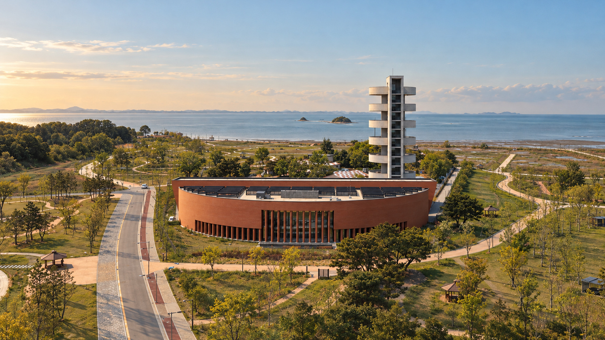 `@maehyang_peace` |
| **Shot 06** (09.4-11.3s) | **[Golden Reed & Zigzag Deck Skim ➔ Lake Sphere Sculpture ➔ Water Submersion]** | **동탄 호수공원 억새밭 & 지그재그 산책로 & 원형 구체 조형물 100% 일치**: 사진(@dongtan_skyline) 그대로의 **황금빛 억새 테라스와 기하학적 지그재그 데크 산책로 위를 초저공 활공 ➔ 호수 위에 떠 있는 상징적인 둥근 구체 조형물(Spherical sculpture) 옆을 지나 수면 물보라를 뚫고 돌진 ➔ 기포가 솟구치는 에메랄드빛 바닷물 속으로 잠입** (유리 고층빌딩 오류 100% 박멸) | 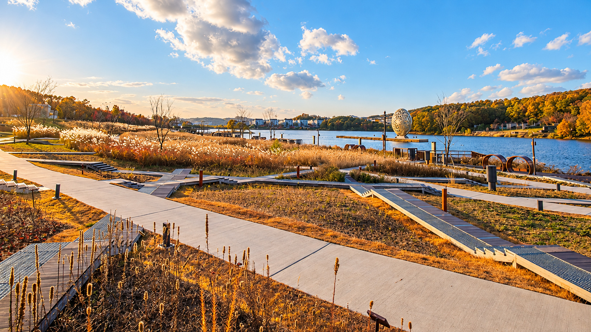 `@dongtan_skyline` |
| **Shot 07** (11.3-13.1s) | **[45-Degree Sea Surface Breach ➔ Sky Soar ➔ Cable Car Encounter]** | **바다 수면 45도 박차고 분출 ➔ 해상 케이블카 조우**: 바닷속에서 **45도 대각선 각도로 거친 바다 포말을 뚫고 수면 밖으로 솟구쳐 나와(Explosive Surface Breach)** 푸른 하늘로 비상 ➔ 서해랑 케이블카 빨간 캐빈 옆을 바짝 스쳐 비행 | 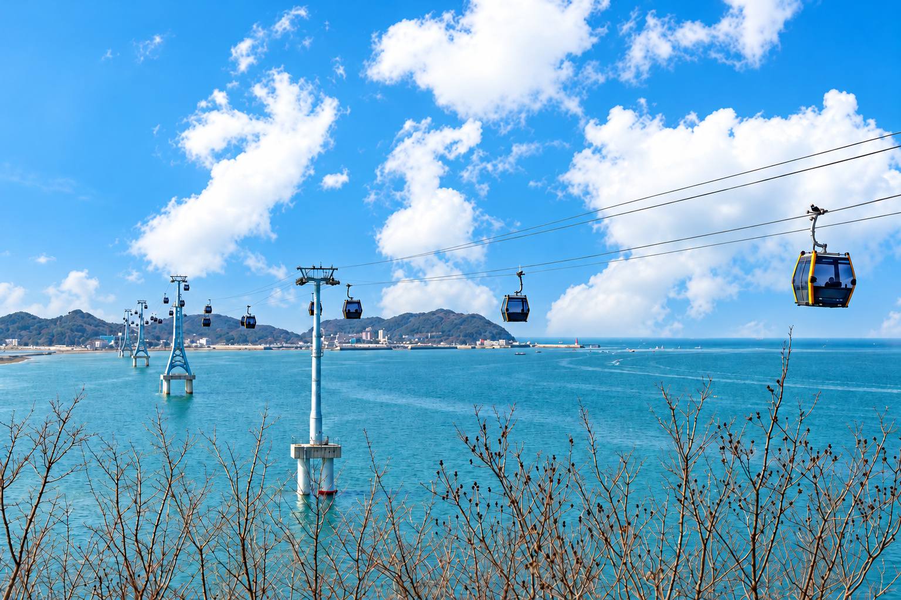 `@seohaerang_bay` |
| **Shot 08** (13.1-15.0s) | **[Crash Push-In to Harbor Waterfront ➔ Gungpyeong Port Sunset Lock]** | **궁평항 수산시장 항구 & 방파제 위 진홍빛 대낙조 정중앙 락**: 허공에 해만 덜렁 뜨는 오류를 차단하고, 케이블카 너머 **궁평항 수산시장 건물(@gungpyeong_sun)과 방파제, 피싱피어 데크로 초고속 크래시 푸시인** ➔ 궁평항 항구 풍경 위로 서해 바다 수평선을 붉게 물들이는 장엄한 진홍빛 태양 구체 정중앙 스틸 락 **[End State Lock]** | 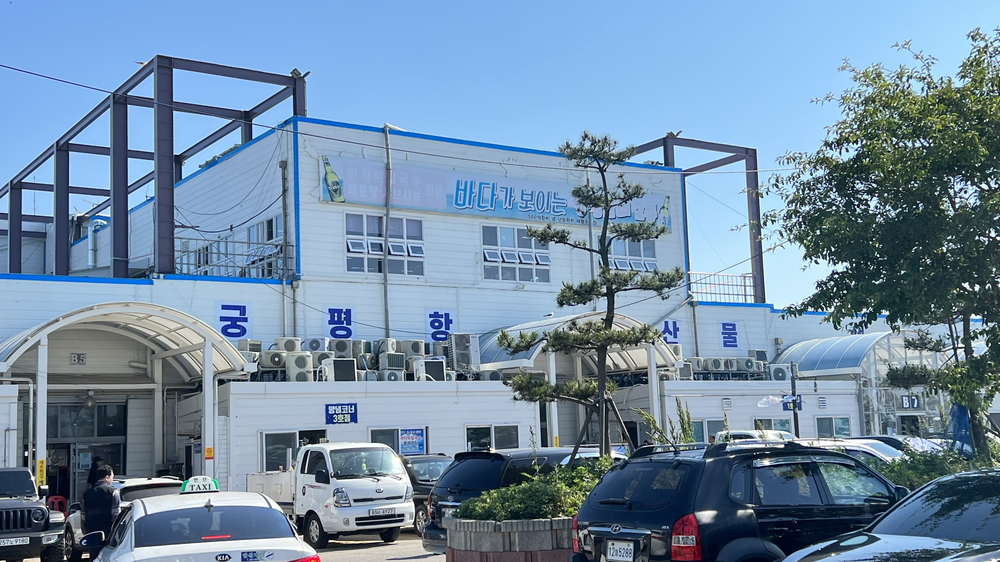 `@gungpyeong_sun` |

---

## Part 3: 미래의 바다 — 기적의 환호에서 비전으로 (00:45 - 01:05 / 20초 마스터 / 8컷)
> **[화면 질감 & 광학 특성]**: 초격차 8K HDR 헐리우드 블록버스터 마스터 렌즈 (Cooke 85mm T2.0), 크리스탈 유체 역학, 극실사 인체 피부 질감

| 샷 번호 / 타임코드 | 카메라 앵글 및 트랜지션 기법 | 화면 질감 및 물리적 연출 묘사 | 참조 에셋 & 태그 |
| :--- | :--- | :--- | :--- |
| **Shot 09** (00.0-02.5s) | **[Road Soar-Up ➔ Aerial Reveal of Yacht]** | **도로 공중 솟구침 & 공중 요트 샷 개방**: 도로를 달리던 카메라가 공중으로 시원하게 솟구쳐 오르며(물속 0%) **에메랄드빛 전곡항 바다 위를 가르는 럭셔리 요트(`@yacht_marina`) 전경을 공중에서 멋있게 개방** | 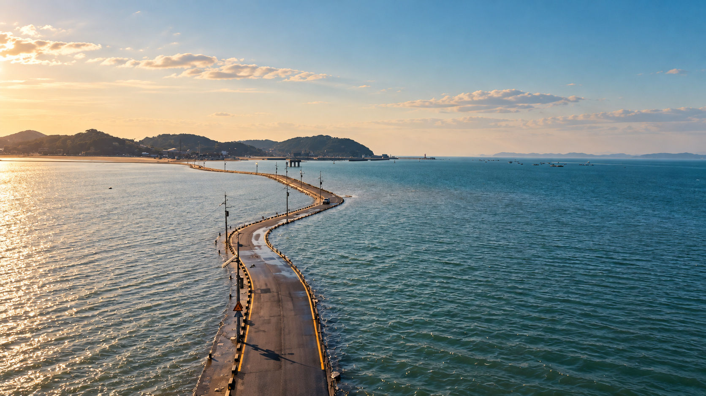 `@jebudo_passage` |
| **Shot 10** (02.5-05.5s) | **[Head-On Approach ➔ 180-Degree Spin Turn ➔ Stern Chase & 100% Lens Splash]** | **요트 정면 접근 ➔ 180도 스핀 턴 ➔ 선미 추격 & 렌즈 100% 물보라 덮기**: 공중에서 내려와 요트 정면을 마주하며 돌진 ➔ 요트가 스쳐 지나갈 때 **카메라가 즉각 180도 회전 스핀 턴을 돌아 요트 뒤쪽을 바라봄** ➔ **180도 돌아선 상태에서 전속력으로 멀어지는 요트 뒤를 트래킹하며 바짝 추격** ➔ 선체 후미에서 솟구친 거대한 물보라가 **카메라 렌즈를 100% 완전히 덮어버림** ➔ 물방울이 흘러내리며 소나무 숲으로 자연스럽게 전환 | 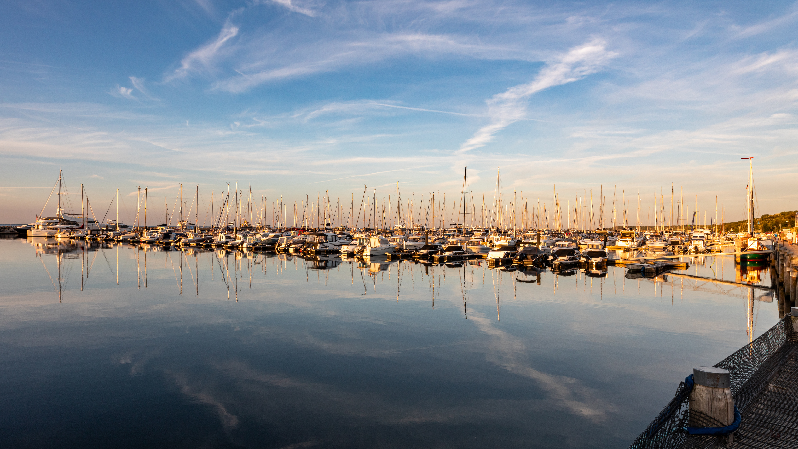 `@yacht_marina` |
| **Shot 11** (04.0-06.0s) | **[Droplets Stream Down Reveal ➔ Pine Canopy Descent]** | **렌즈 물방울 흘러내림 & 융건릉 200년 적송 수관 하강**: 렌즈 표면의 물방울이 흘러내리며 시야 개방 ➔ **울창한 적송 수관과 붉은 나무 기둥 사이를 지나 솔잎이 깔린 지상으로 부드럽게 하강** (감성 미사여구 박멸, 거친 솔잎 돌풍과 나무 삐걱임 물리음 배치) | 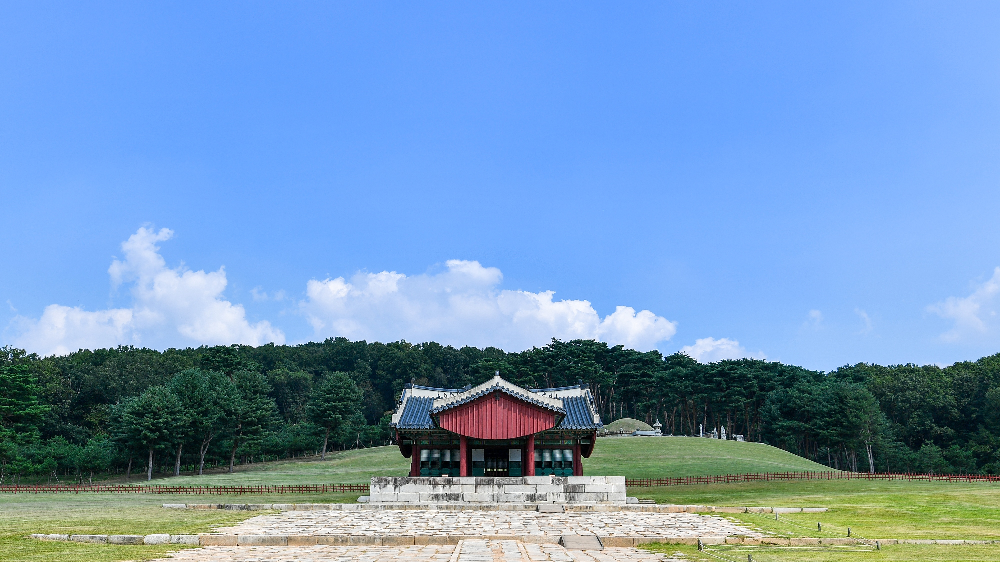 `@yungneung_pine` |
| **Shot 12** (06.0-09.0s) | **[Natural Nightfall ➔ 3D Drone Fountain Ring Orbit]** | **동탄 분수 링 설비 & 3차원 드론 회전 비행**: 밤으로 전환된 동탄 호수공원에 도착 ➔ **솟구치는 원형 강철 분수 링 설비와 고압 수류 기둥 주위를 유려하게 3차원 드론 회전 선회(Drone Orbit)** (쇼/레이저 음악 트리거 박멸, 고압 수류 굉음 물리음 배치) | 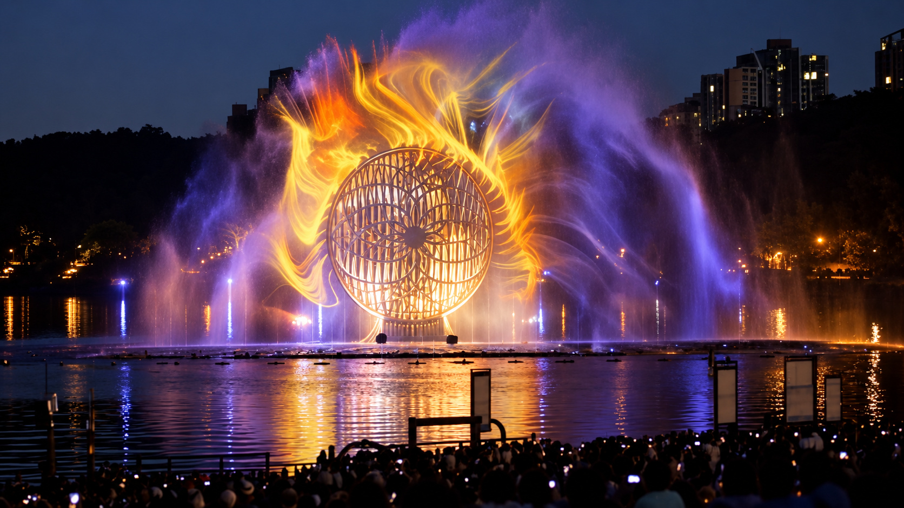 `@dongtan_luna` |
| **Shot 13** (09.0-11.5s) | **[Drone Descent to Promenade ➔ Family Framing]** | **수변 데크 드론 하강 & 가족 프레이밍**: 드론 카메라가 수변 데크로 하강 ➔ 화면 왼쪽의 거대한 분수 물기둥을 미소 지으며 바라보는 한국인 가족(`@citizens_cheer`) 포착 (가족 시선 왼쪽 분수대 100% 락) | 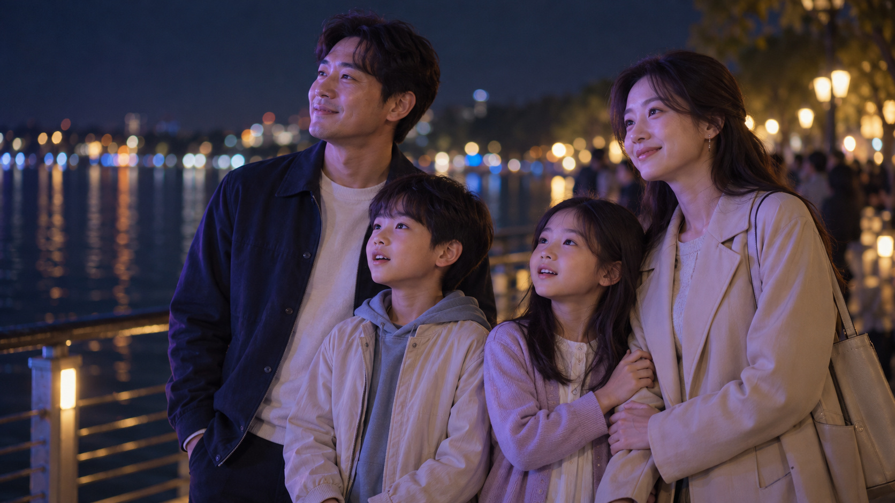 `@citizens_cheer` |
| **Shot 14** (11.5-13.0s) | **[Fast Right Whip-Pan ➔ Crepe Myrtle Macro Focus ➔ White Canvas]** | **가족 회전 후 오른쪽 초고속 휩팬 ➔ 백일홍 매크로**: 가족 주변을 돌다 **오른쪽으로 매우 빠른 휩팬(Fast Whip-Pan)** ➔ 데크 난간의 진홍빛 백일홍 꽃(`@crepe_myrtle`) 매크로 클로즈업 ➔ 순백의 캔버스로 용해 | 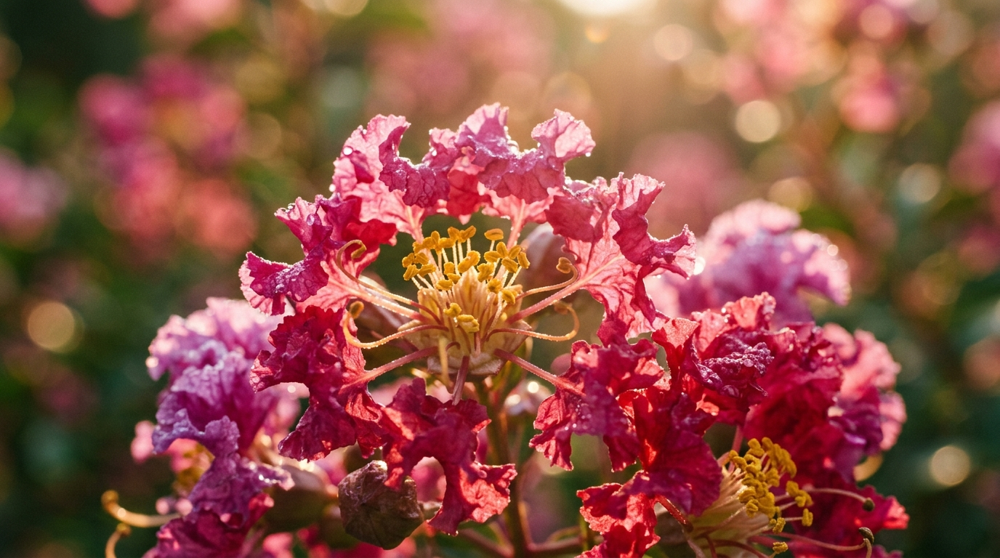 `@crepe_myrtle` |
| **Shot 15** (13.0-15.0s) | **[Thick/Thin Vector Assembly ➔ Uncropped Full Frame Graphic Lock]** | **굵은선·얇은선 키네틱 조립 & 우측 아치 문양 100% 완전 보존 락**: 상하좌우에서 굵은 선과 얇은 선들이 고속 직선으로 들어와 곡선으로 휘감기며 조립 ➔ **화면 우측(Right 35%)의 세로형 기하학 아치 패턴이 1픽셀도 잘리지 않고 프레임 안에 100% 온전히 보존된 공식 타이틀 카드(`@ending_logo`) 정중앙 스틸 락 [End State Lock]** | 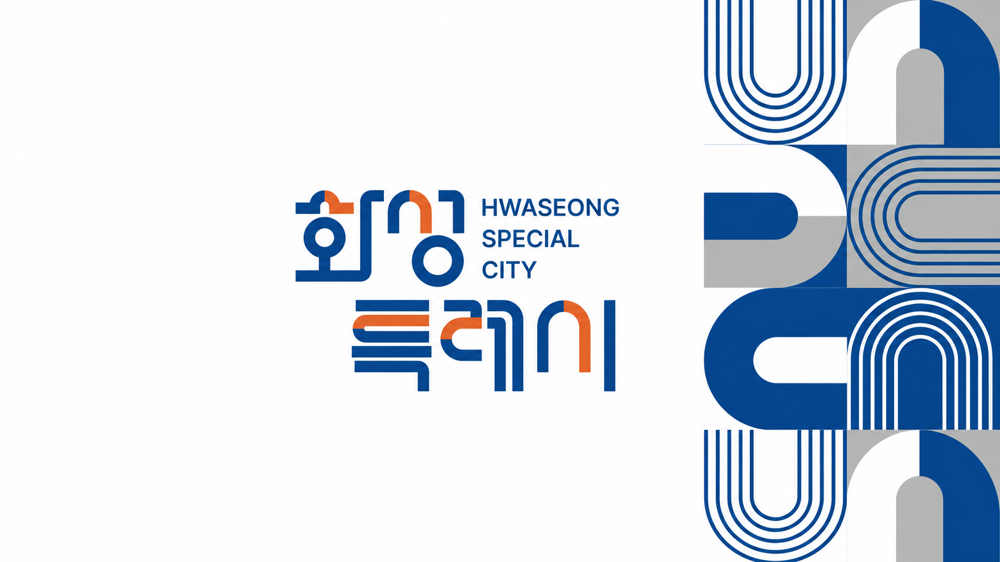 `@ending_logo` |
