# 화성 CF — 실사 장소·캐릭터 에셋

실제 검색 사진과 공식 마스코트를 참조한 AI 생성 이미지. 현장 촬영본과 구별하여 사용합니다. [출처·태그 매핑](README.md) · [생성 프롬프트](../image_prompts.md)

## 🎬 Part-1 시네마틱 8패널 스토리보드 콘티 (Director's Grid Sketch)

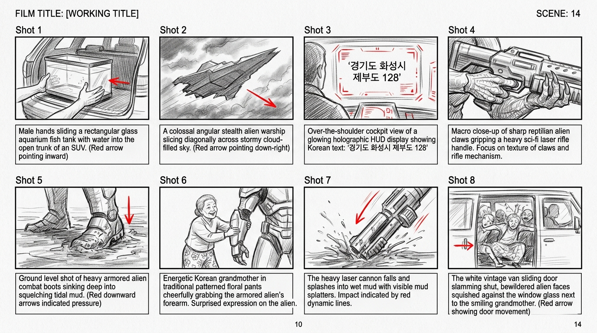

## 공룡 외계인 4인방 · @alien_squad

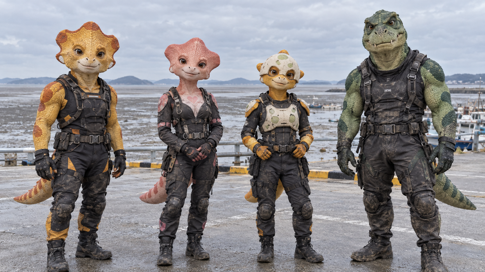

## 옥분 할머니 · @grandma_okboon

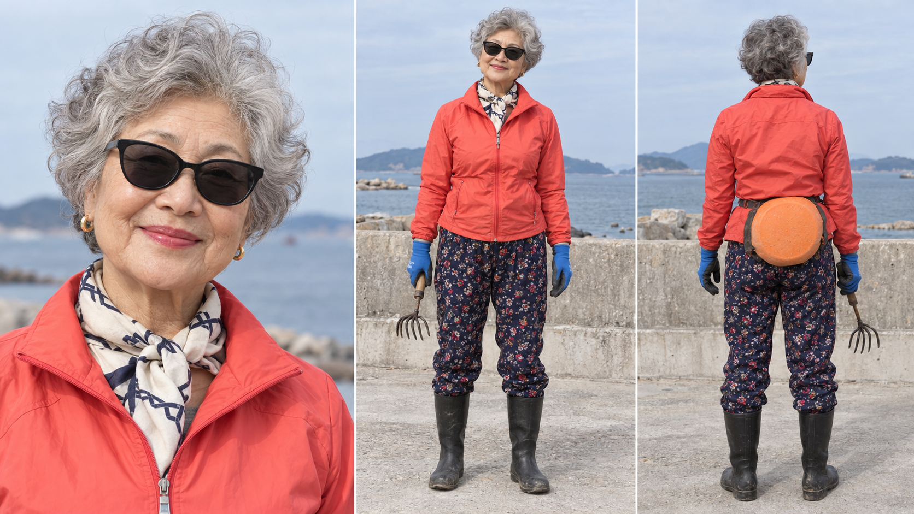

## 회춘한 청년 · @reborn_youth

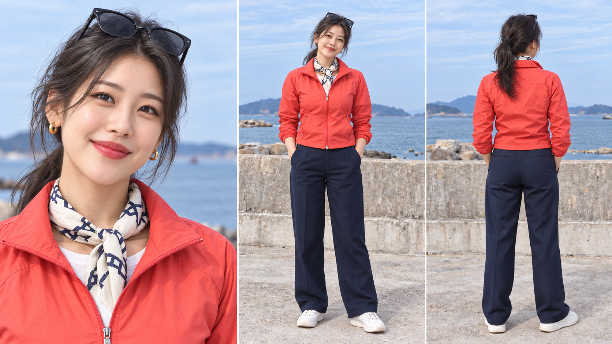

## 외계 모선 · @alien_mothership

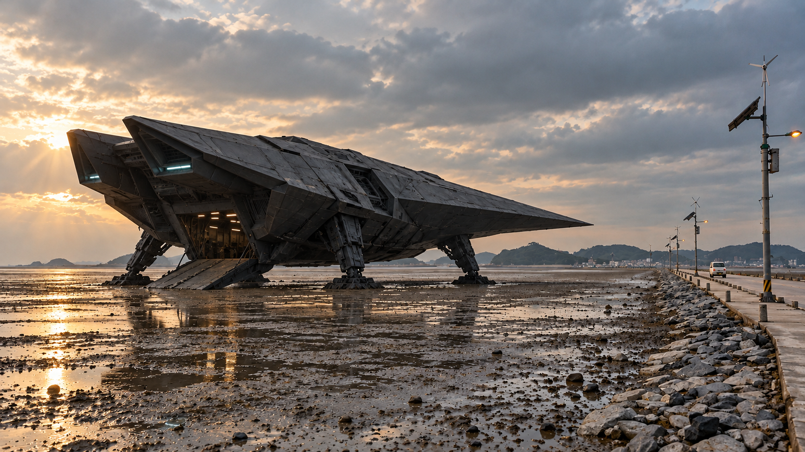

## 제부도 갯벌 · @jebudo_mudflat

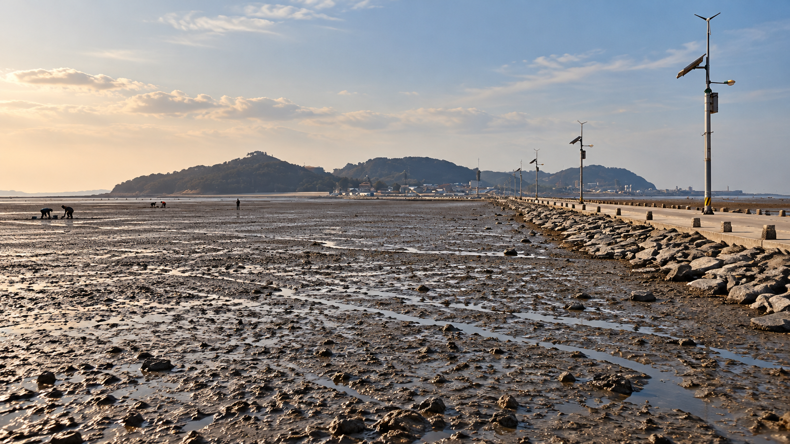

## 전곡항 마리나 · @jeongok_marina

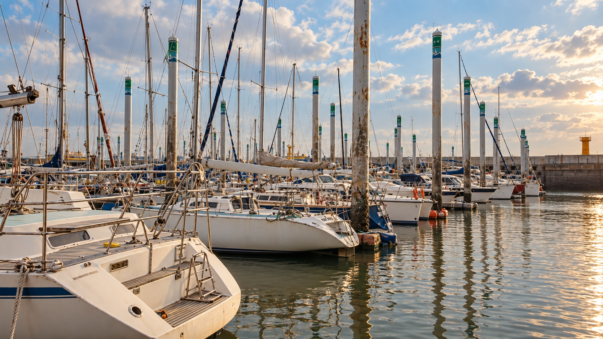

## 송산포도 · @songsan_vineyard

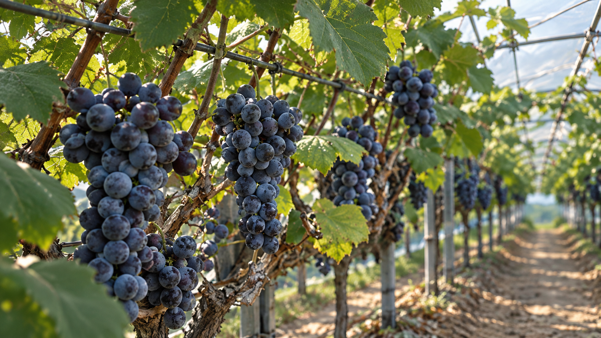

## 고정리 공룡알 화석 · @gojeongri_dino_site

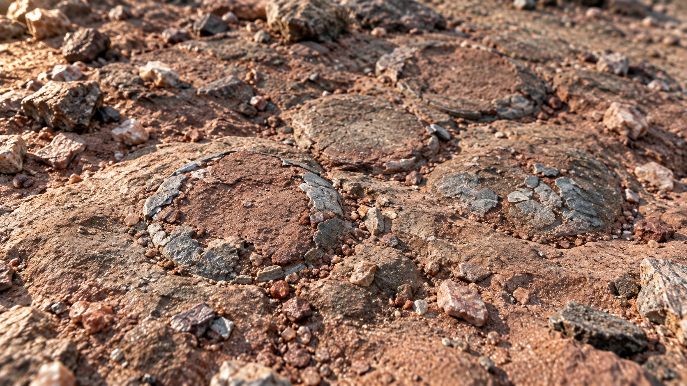

## 고정리 데크길 · @gojeongri_boardwalk

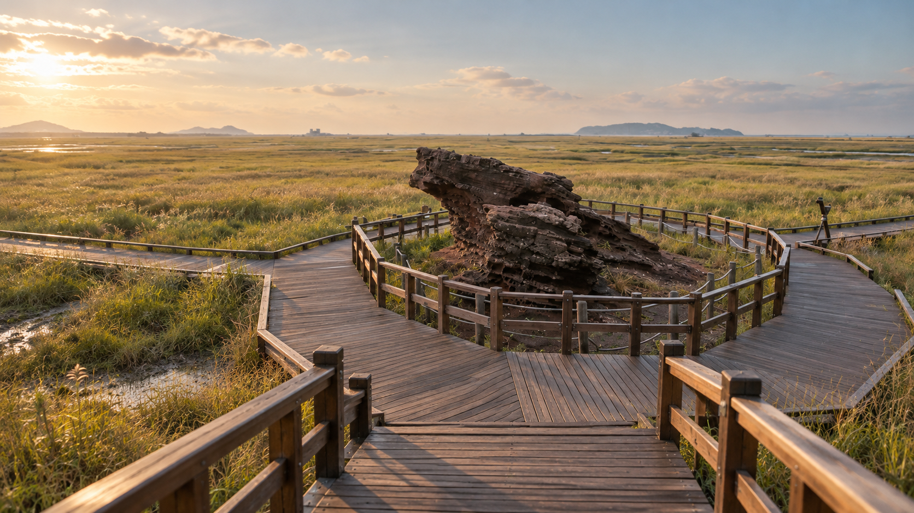

## 반도체 클린룸 재구성 · @hwaseong_cleanroom

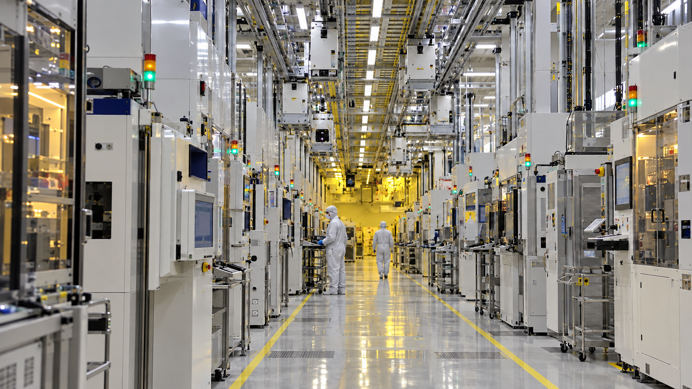

## 엔딩용 가상 벽화 세트 · @hwaseong_mural_emblem

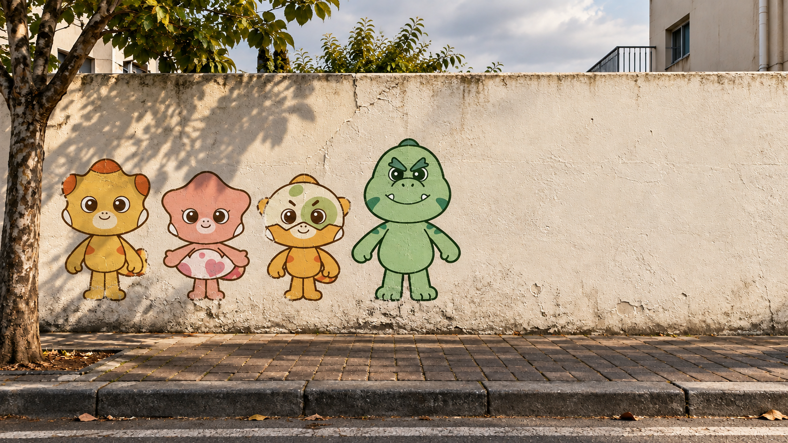

## 레이저건 · @alien_laser_rifle

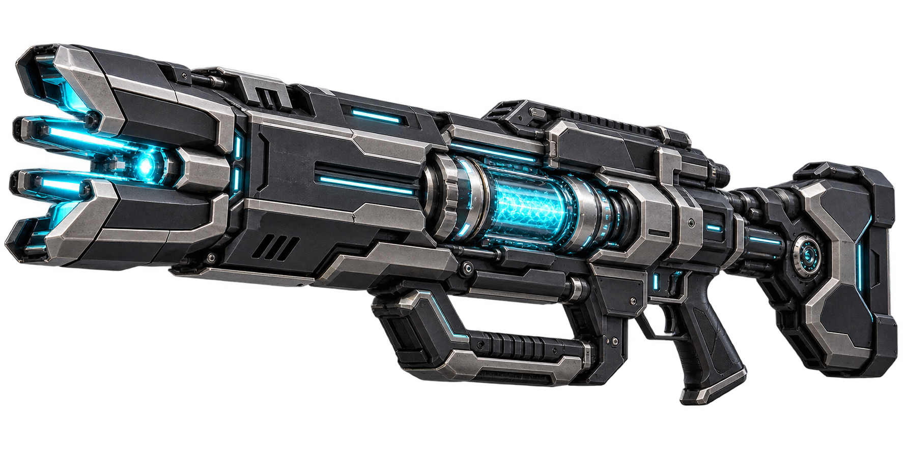

## 공식 로고 · @hwaseong_bi_logo

## 삼성전자 화성 V1 EUV 생산동 실제 외관 기준 · @samsung_semiconductor_ext

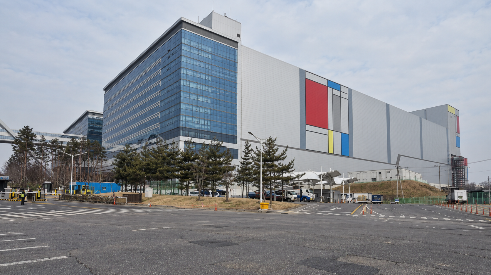

## 향남 대원제약 생산동·유리 사무동 실제 외관 기준 · @hyangnam_biovalley_ext

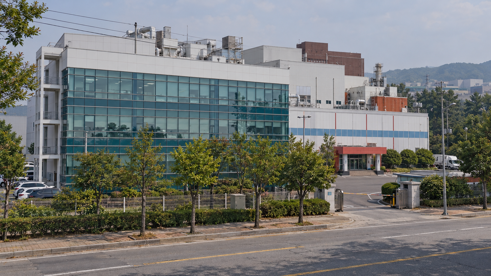

## 궁평항횟집 실제 실내 기준의 회 한 상 · @gungpyeong_restaurant

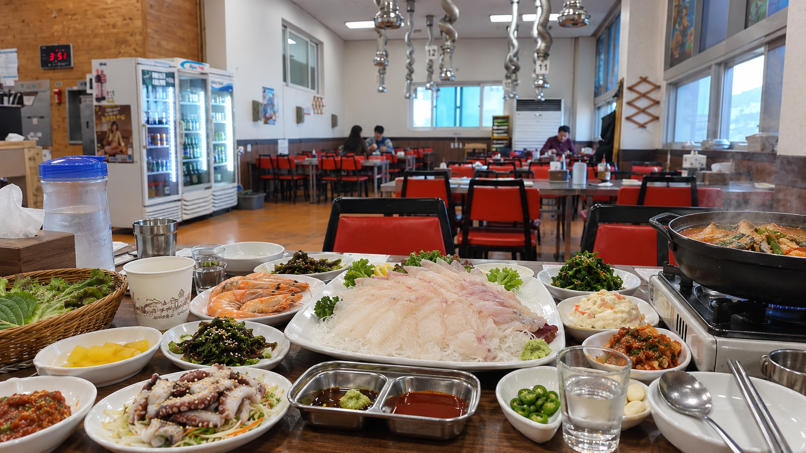

## 콕핏 항법 디스플레이 · @navigation_hud

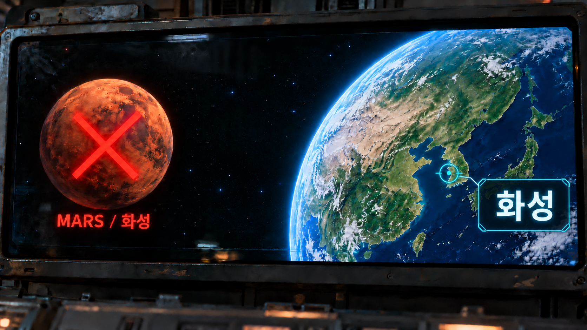
